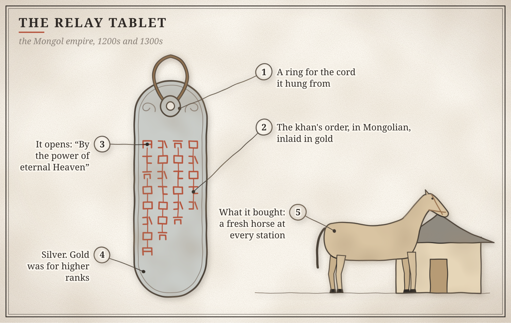
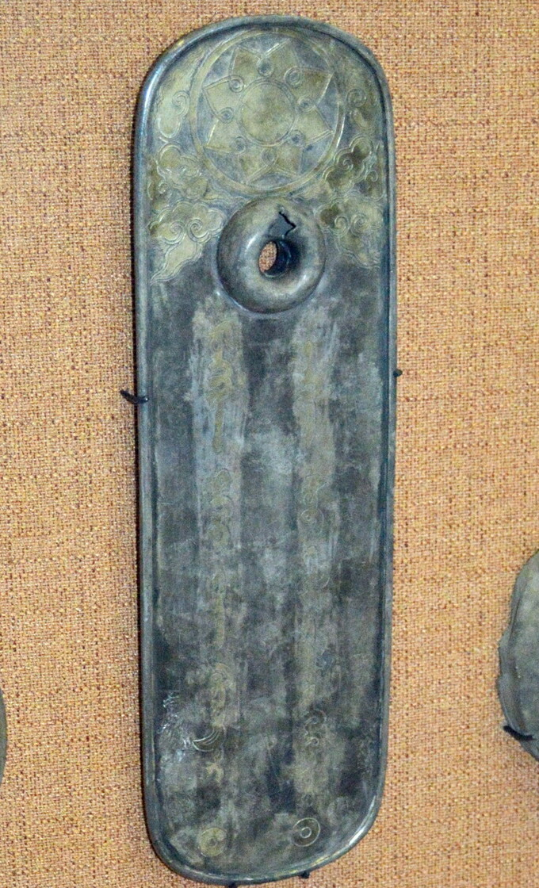

# The relay tablet

| | |
|---|---|
| **First made** | By the Mongols in the early 1200s, after Jin models |
| **Made of** | Silver, often gilded. Gold for high ranks, wood for low |
| **What it does** | Orders, in the khan's name, horses and food for the bearer |
| **Before it** | Passes for the official roads of Tang, Liao and Jin China |
| **After it** | Russia kept the relay roads, with paper passes, into the 1800s |

## Why it mattered

In 1266 Kublai Khan sent two Venetian merchants, Marco Polo's father and uncle, back west with a letter for the pope. He also gave them a tablet of gold. On it, Marco wrote later, was the order that they be supplied with everything they needed in every country they crossed: horses, escorts and whatever else they asked for.

A tablet that worked on anyone was easy to abuse. Princes and princesses handed them out, merchants got hold of them, and bearers took horses and food from villages as well as from the stations. Persian historians wrote of the ruin this caused. About 1300 Ghazan, the Mongol ruler of Persia, cancelled the old tablets. The new ones carried the bearer's name and went back when his service ended.

## The real thing

*A silver tablet of Özbeg, khan of the Golden Horde from 1313 to 1341, in the State Historical Museum, Moscow. Photo: Lapot, CC0.*
