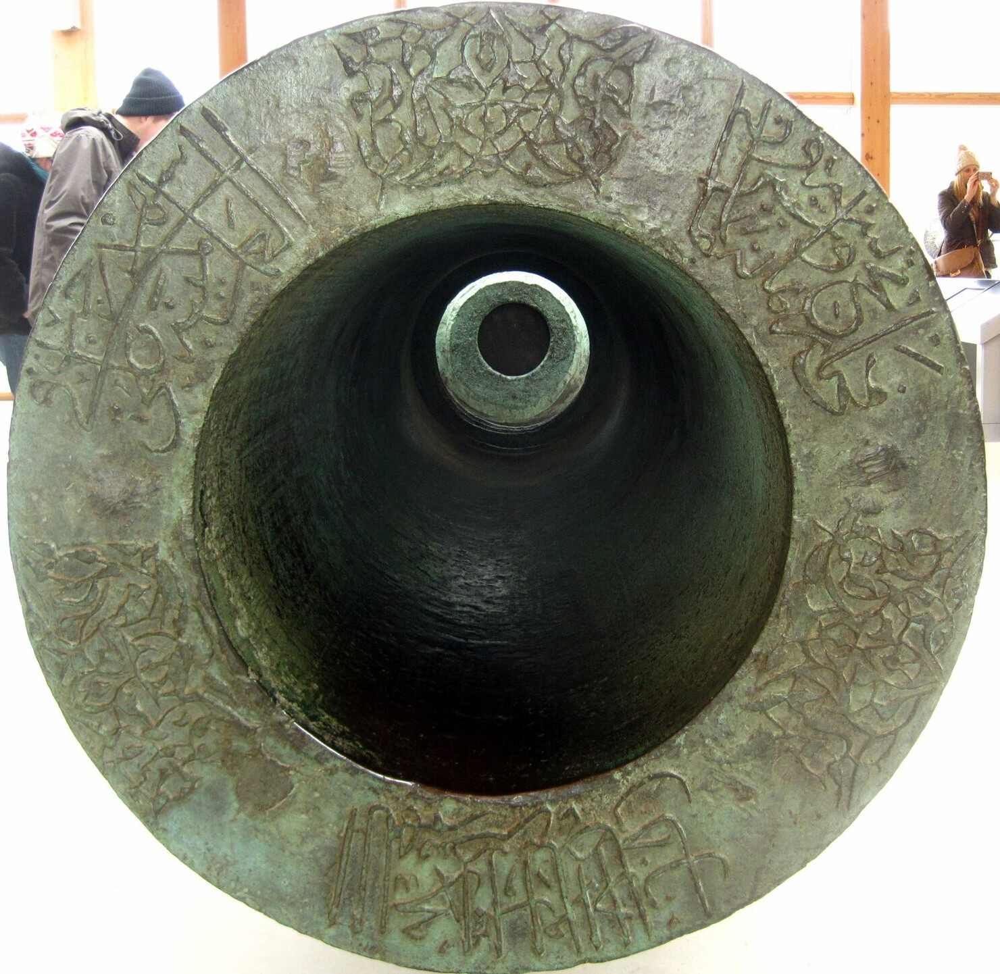

# The great bombard

| | |
|---|---|
| **First made** | In Europe by the late 1300s. The biggest were Ottoman |
| **Made of** | Cast bronze, or iron bars bound with hoops |
| **What it does** | Throws a huge stone ball almost flat against a wall |
| **Before it** | The trebuchet, which lobbed stones in a high arc |
| **After it** | Smaller guns firing iron balls, on wheels |

## Why it mattered

The Dardanelles Gun was cast in 1464 by Munir Ali, an Ottoman founder, on the model of the guns that broke Constantinople. It weighs about 17 tonnes and throws a stone ball 63 centimetres across. Its two halves screw together, so that it could travel in pieces, and sockets round each end held the levers that turned them.

Guns like this soon went out of date in the field. Smaller guns took over, firing iron balls from longer barrels, and they could travel on wheels. The great bombards stayed behind in the forts on the Dardanelles, the strait that leads to Constantinople. In 1807 a British fleet forced its way through, and this gun fired on it, three and a half centuries after it was cast.

## The real thing

*Looking into the muzzle of the Dardanelles Gun at Fort Nelson, Hampshire. At the far end of the wide bore is the mouth of the narrow powder chamber. Photo: Simon Cope, CC BY-SA 2.0.*
