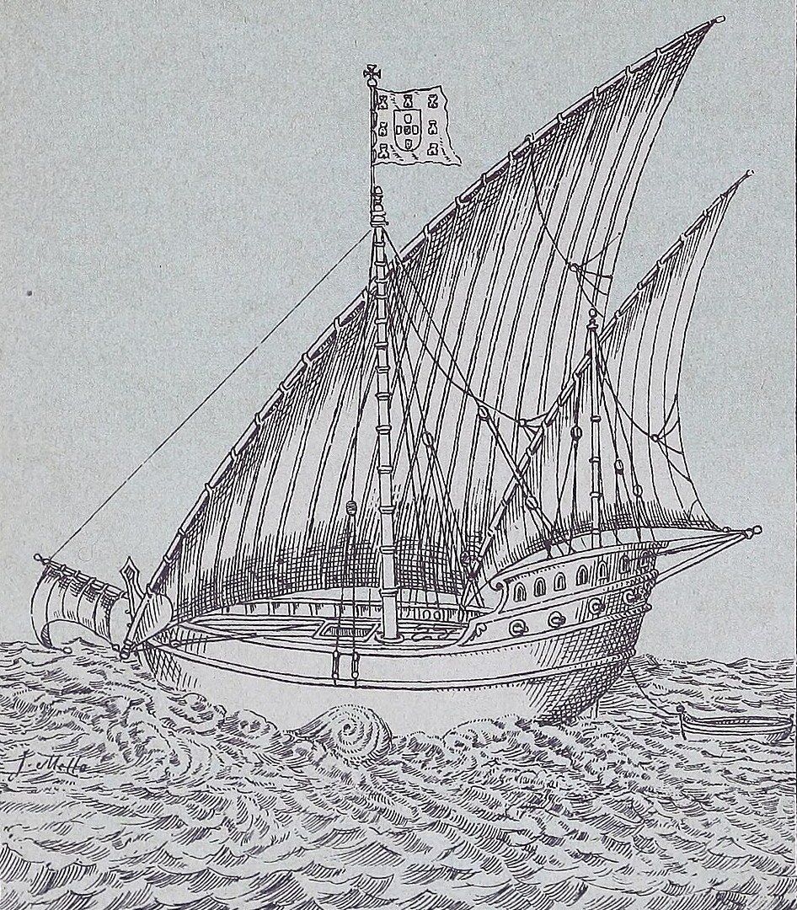

# The caravel

| | |
|---|---|
| **First made** | A fishing boat by the 1200s, rebuilt for the ocean in the 1400s |
| **Made of** | Wooden planks laid edge to edge on a frame; canvas sails |
| **What it does** | Sails closer to the wind than a square-rigger, in shallow water |
| **Before it** | Square-rigged ships that needed the wind behind them |
| **After it** | The carrack and the galleon: bigger, mostly square-rigged |

## Why it mattered

Bartolomeu Dias rounded the southern tip of Africa in 1488 with two caravels and a supply ship to carry their food. Four years later Columbus sailed with two more, the Niña and the Pinta, beside a bigger ship. In the Canary Islands he had the Niña's triangular sails taken down and square ones put up, because the crossing ahead ran straight before the wind.

Later caravels often carried both kinds: a square sail on the foremast for running before the wind, and triangular ones behind for working against it. Even so, a caravel was too small to carry much. The cargoes went in larger ships, and caravels were kept for exploring and for guarding the fleets.

## The real thing

*A Portuguese caravel, engraved in 1900 from a painting of the 1500s in the Convent of Madre de Deus, Lisbon. No caravel of the time survives. Engraving: public domain.*
