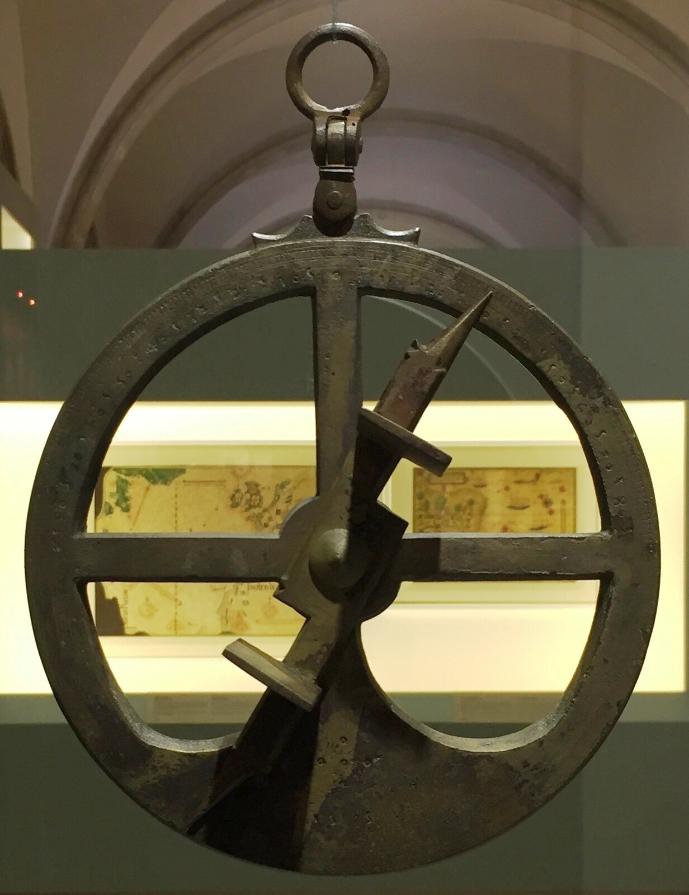

# The sea astrolabe

| | |
|---|---|
| **First made** | In Portugal in the late 1400s |
| **Made of** | Brass, cast thick and heavy so that it hangs still |
| **What it does** | Measures the sun's height at noon, to find the latitude |
| **Before it** | The quadrant with a plumb line, used at sea by 1461 |
| **After it** | The Davis quadrant of 1594, later the octant and sextant |

## Why it mattered

On a rolling deck the disc swung, and readings wandered. When Vasco da Gama put in at a bay on the west coast of southern Africa in 1497, he went ashore to measure the sun with a large wooden astrolabe set up on land. A chronicler writing forty years later explained why: the small brass ones could not give a trustworthy reading on a moving ship.

More than a hundred sea astrolabes survive, and many of them were raised from shipwrecks. They stayed in use until the 1600s. Then they gave way to instruments that the navigator could hold with his back to the sun, reading its shadow instead of squinting into its light.

## The real thing

*A sea astrolabe of about 1600, raised in 1994 from a shipwreck at Aveiro, Portugal, and now in the Navy Museum, Lisbon. Photo: Hispalois, CC BY-SA 4.0.*
