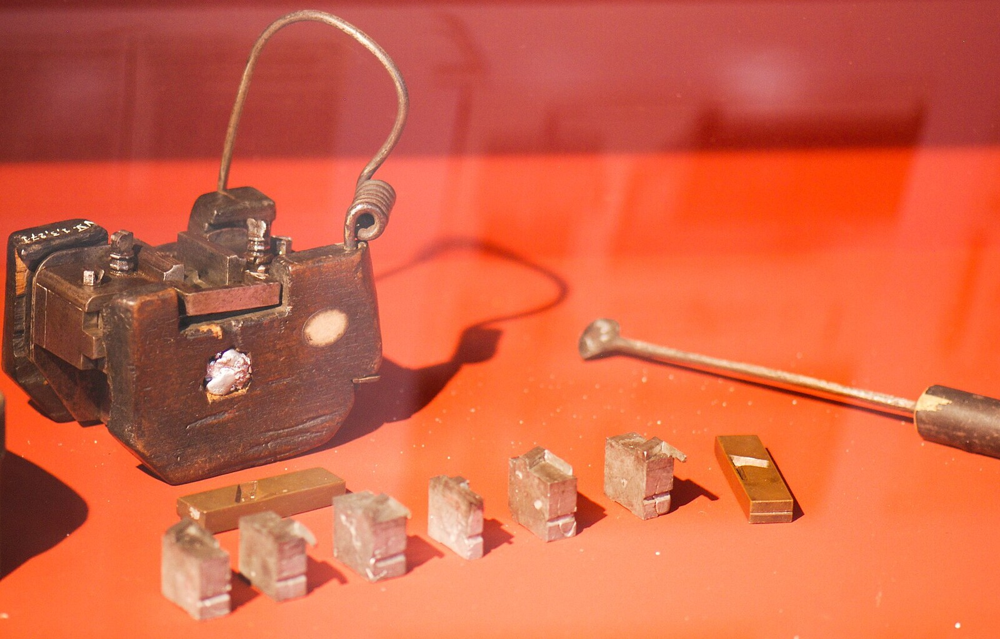

# The type mould

| | |
|---|---|
| **First made** | By Johannes Gutenberg in Mainz, between about 1436 and 1450 |
| **Made of** | A steel punch, a copper matrix, and a mould of two metal halves held in wooden grips |
| **What it does** | Casts metal letters one after another, every one of them the same height |
| **Before it** | Pages carved whole in wood, and in Korea metal characters cast one by one, each from its own model |
| **After it** | Casting machines from the 1830s, which worked a mould like this one with a crank |

## Why it mattered

The trick was in how the two halves fitted. Clamped together, they always closed to the same depth, so every letter came out the same size from front to back and stood in a straight line with the others. From side to side they could slide. The caster set them close for an i and wide for an m, changed the matrix, and went on casting. A practised worker could turn out four or five thousand letters a day.

The metal mattered too. Lead on its own is soft and shrinks as it cools. Gutenberg's mixture added tin and a little antimony, which made the letters hard enough to stand up to the press and let them set with sharp edges.

## The real thing

*A type mould in its wooden case, with matrices and cast pieces in front of it and a ladle beside it, at the Plantin-Moretus Museum, Antwerp. Photo: Thomas Quine, CC BY 2.0.*
