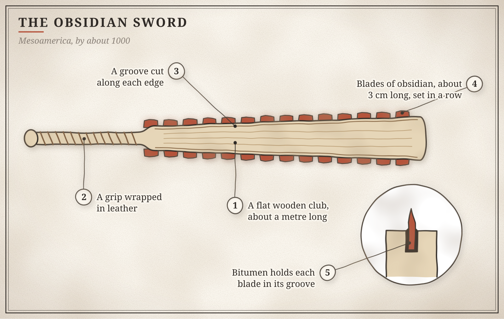
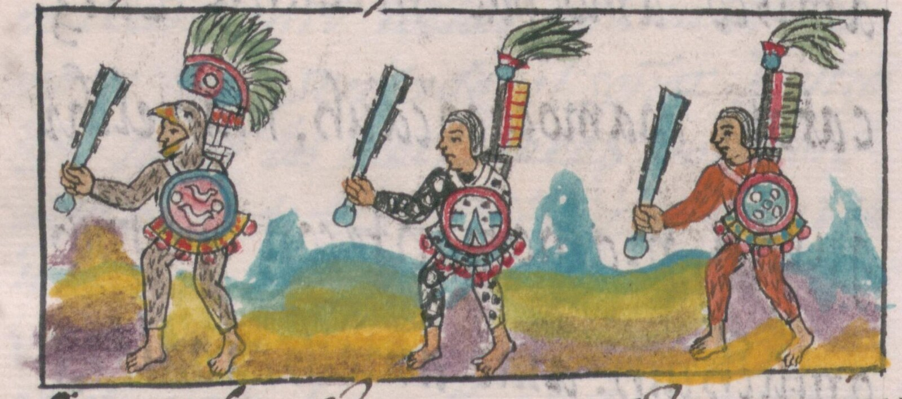

# The obsidian sword

| | |
|---|---|
| **First made** | Mesoamerica. Carved at Chichén Itzá about 1000 |
| **Made of** | A wooden club edged with blades of volcanic glass |
| **What it does** | Cuts like a sword; a blow to the legs takes a man alive |
| **Before it** | Wooden clubs, and spears hurled with a spear-thrower |
| **After it** | Steel won. The last whole one burned in Madrid in 1884 |

## Why it mattered

Obsidian breaks to an edge sharper than a steel razor. A craftsman set a block of the glass between his feet and pressed down on its edge with a stick, and at each push a long, thin blade sprang off. Broken into short pieces, the blades were glued along the club's edges.

The Spanish learned to fear it. In 1519, in a battle against the Tlaxcalans, warriors pulled a rider's lance from his hand and killed his mare with a single cut to the neck. Against steel, however, the glass was brittle. It shattered on a sword or a breastplate, and it chipped and dulled after a few hard blows.

## The real thing

*Warriors with obsidian swords, painted by Nahua artists for the Florentine Codex in the 1570s. No complete sword survives. Public domain.*
