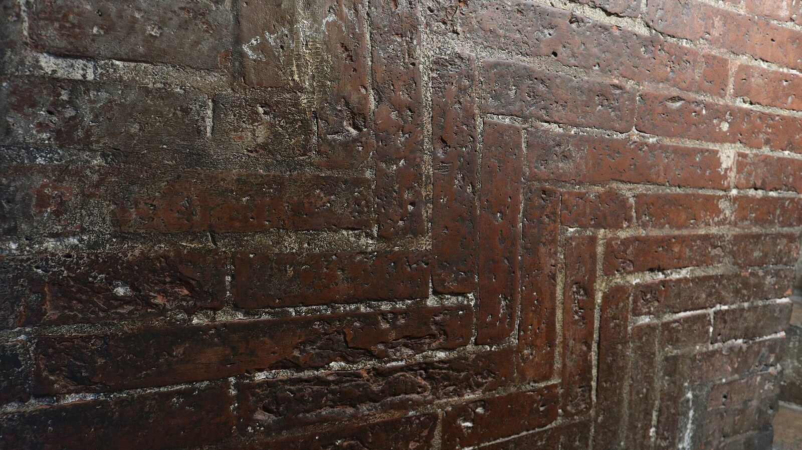

# The brick dome

| | |
|---|---|
| **First made** | Florence, from 1420. Closed in 1436, lantern finished 1461 |
| **Made of** | Over four million bricks, sandstone beams and iron clamps |
| **What it does** | Roofs a gap 44 metres wide with no wooden frame beneath |
| **Before it** | Vaults and domes built over wooden frames, taken away after |
| **After it** | Saint Peter's in Rome, also a dome of two shells |

## Why it mattered

Every brick and stone had to be lifted more than 50 metres before it could be laid. For this Brunelleschi designed a hoist turned by oxen walking in a circle. Its gears let it raise or lower a load while the oxen kept walking the same way, so they never had to be turned round. Leonardo da Vinci later made drawings of it.

The dome rests on eight great ribs at its corners, with sixteen more hidden between the shells. The outer shell is only 60 centimetres thick at the bottom and half that at the top. The marble lantern that crowns it, also of Brunelleschi's design, was begun a few months before he died in 1446.

## The real thing

*Brickwork inside the dome of Florence cathedral, seen from the passages between the shells. Bricks set on end break into the flat courses. Photo: Maksim Sokolov, CC BY-SA 4.0.*
