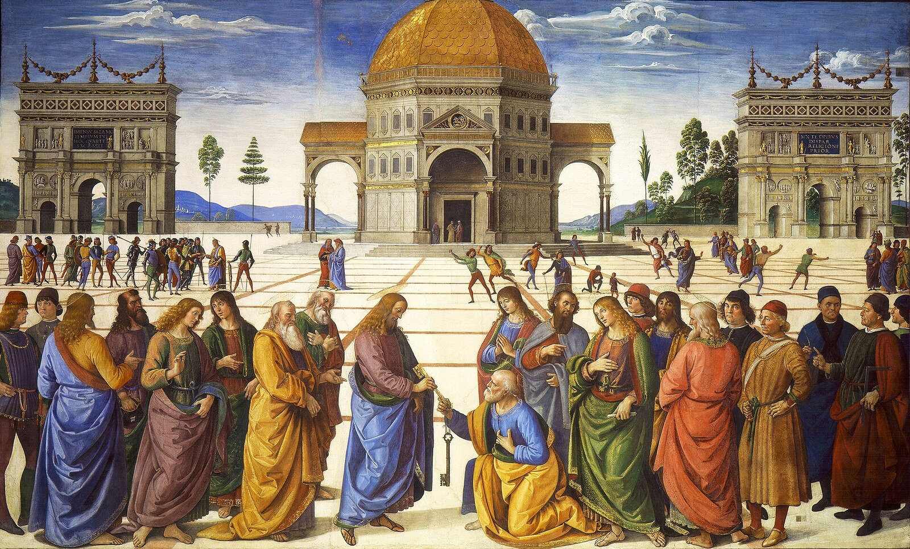

# The vanishing point

| | |
|---|---|
| **First made** | Florence, by Brunelleschi about 1415. Written down in 1435 |
| **Made of** | A ruler, an eye held still and some geometry |
| **What it does** | Shows depth on a flat surface, each thing sized by distance |
| **Before it** | Rough rules, with receding lines that met in several places |
| **After it** | The standard way of painting in Europe until the 1900s |

## Why it mattered

The scholar who wrote the method down, Leon Battista Alberti, began at the bottom edge of the picture. The painter divided it into equal steps and joined each one to the vanishing point. He set that point at about the height of a man standing in the picture, so that the viewer and the painted people seemed to stand on the same floor.

The tiles then checked the work. A line drawn diagonally through their corners runs to a second point on the horizon, and its distance from the vanishing point equals the distance from the eye to the picture. A badly spaced floor fails the test at once. Some forty years later Piero della Francesca, a painter who was also a mathematician, wrote a whole book on it.

## The real thing

*Christ giving the keys to Saint Peter, painted by Perugino in the Sistine Chapel in 1481 and 1482. The lines of the paving run to the temple door. Public domain.*
