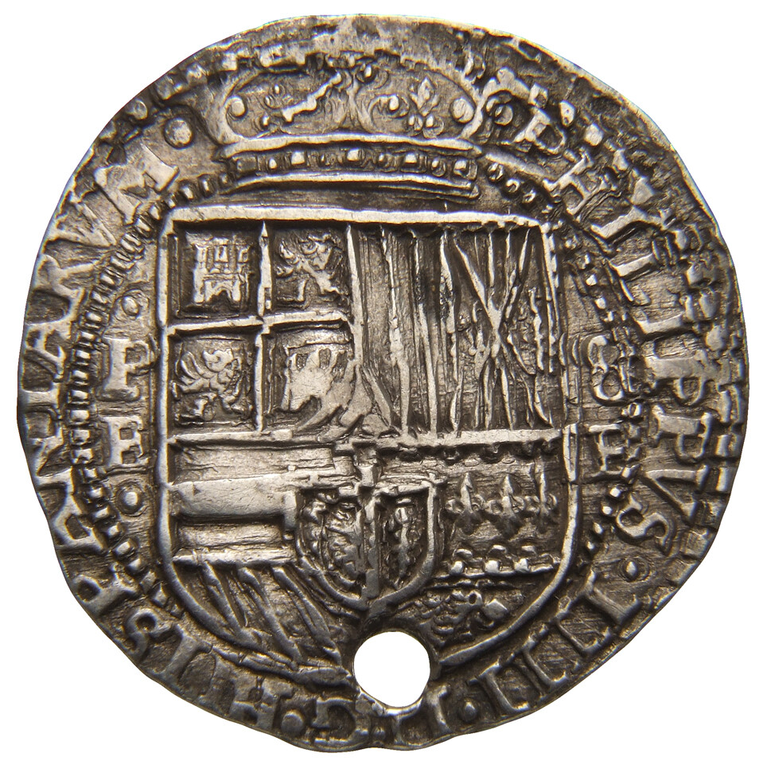

# The piece of eight

| | |
|---|---|
| **First made** | Spain, by a law of 1497. Struck at Potosí from 1575 |
| **Made of** | Silver, 93 parts in 100, about 27 grams |
| **What it does** | A known weight of silver, vouched for by the king's marks |
| **Before it** | Silver weighed out in bars and lumps |
| **After it** | Round coins made by machine, from 1732 |

## Why it mattered

A coin struck by hand came out lumpy, and it often showed only part of the design. Its worth lay in the silver, so the marks mattered more than the picture. The assayer's initial on every coin named the official who had tested the metal, and if the coins fell short, he answered for it.

In the 1640s that check failed. Investigators found that Potosí coins held about three parts of silver in four, against a standard of 93 in 100. The king's inspector had an assayer and a former governor of the town executed, and the bad coins were cut in value. The panic over Potosí silver spread along the trade routes as far as Southeast Asia.

## The real thing

*A piece of eight struck at Potosí in 1651, in the Münzkabinett, Berlin. P is the mint, E the assayer. Photo: Reinhard Saczewski, CC0.*
