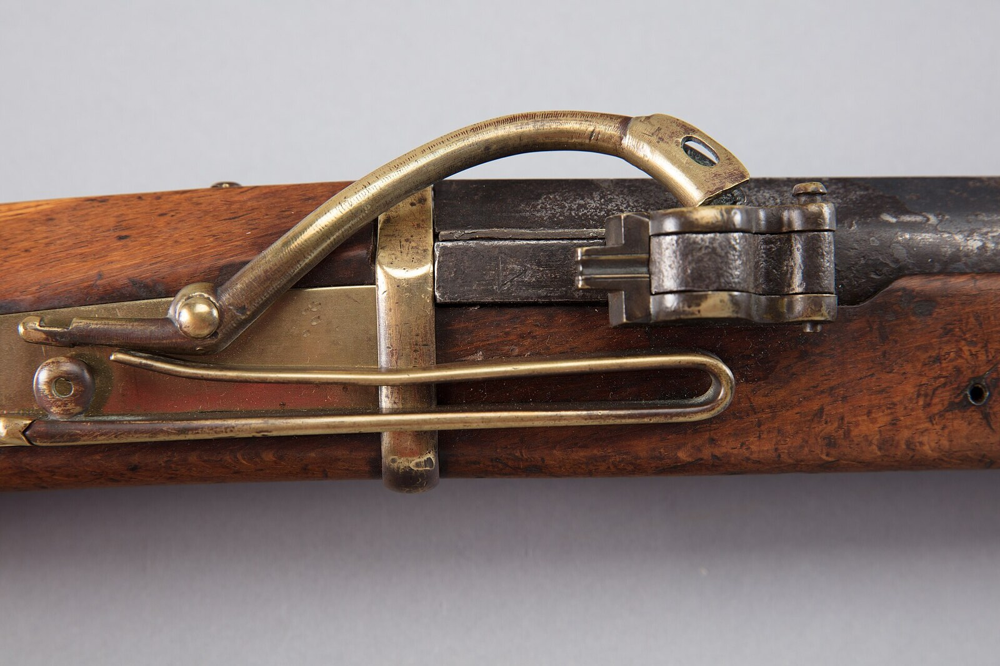

# The matchlock

| | |
|---|---|
| **First made** | Europe, by the 1470s. Reached Japan in 1543 |
| **Made of** | Iron barrel, wooden stock, brass lock, slow-burning cord |
| **What it does** | Brings a burning cord down onto the powder at a trigger pull |
| **Before it** | Hand guns lit by pressing a burning cord on by hand |
| **After it** | The flintlock. Japan kept the matchlock until the mid-1800s |

## Why it mattered

A gun without a lock was clumsy. The gunner, or a helper, pushed a burning cord onto the powder by hand, so his eye was on the touch hole instead of the target. The lock put the cord on a moving arm. A squeeze of the trigger brought it down into the pan while the gunner kept aiming.

The cord had its costs. It had to stay lit for hours, rain could put it out, and at night its glow and its smell gave the gunners away. Japanese gunners added their own refinements. They carried each load of powder and ball in a small bamboo tube to load faster, and for shooting at night they fixed the aim in daylight with measured strings.

## The real thing

*The brass lock of a Japanese matchlock in Auckland Museum, New Zealand. The arm rests over the closed pan, with the spring below. Photo: Auckland Museum, CC BY 2.0.*
