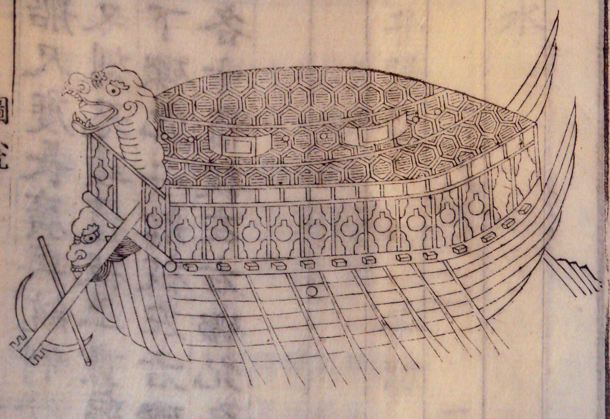

# The turtle ship

| | |
|---|---|
| **First made** | Korea, recorded in 1413. Yi Sun-sin's version, 1592 |
| **Made of** | Wood, roofed with planks studded with iron spikes |
| **What it does** | Rows into an enemy fleet, firing on every side from cover |
| **Before it** | The panokseon, an open-topped Korean warship |
| **After it** | Built in new versions, with more guns, into the 1800s |

## Why it mattered

Yi described the ship to the king in the summer of 1592, after its first fights. Guns fired through the mouth of a dragon's head at the bow and through ports along both sides. The crew inside, he wrote, could watch the enemy without being seen. Rowers and gunners alike worked under the roof.

Later writers often called it the first ironclad warship. However, no Korean record of Yi's time says it was covered in iron plates, and the iron in his report is in the spikes. No turtle ship survives, and no plan from Yi's day. Modern replicas follow two drawings printed in 1795, two centuries after the war, when the king had Yi's writings collected.

## The real thing

*A turtle ship in the collected works of Yi Sun-sin, printed in 1795, the earliest surviving picture of one. Photo: PHGCOM, CC BY-SA 3.0.*
