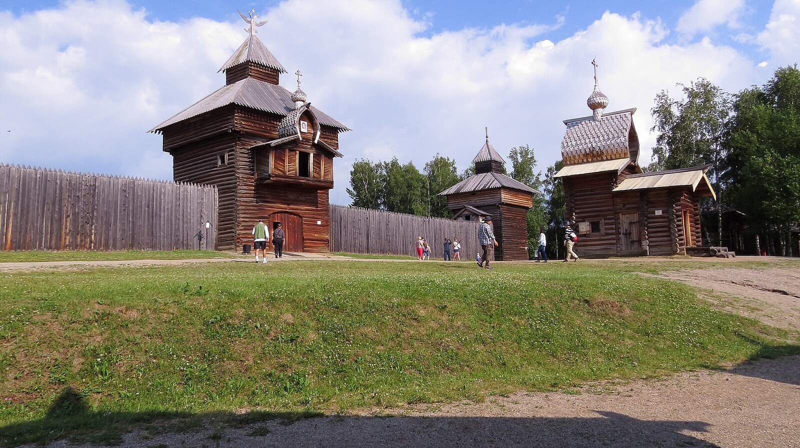

# The log fort

| | |
|---|---|
| **First made** | Russia's frontiers. In Siberia from 1586, at Tyumen |
| **Made of** | Tree trunks set upright in the ground, sharpened at the top |
| **What it does** | Holds a river crossing; guards the furs and the hostages |
| **Before it** | A winter hut, where a party sat out the cold |
| **After it** | Many grew into towns: Tomsk, Yakutsk, Irkutsk |

## Why it mattered

The Russians called it an ostrog, from a verb meaning to shave wood, after its sharpened logs. Most of the peoples of Siberia fought with bows and spears, and against them a wall of logs was enough. Its danger was fire. In the winter of 1634, Yakut warriors besieged the new fort on the Lena for weeks and tried to burn it down, but they failed.

Many of these forts became the centres of towns, as traders and farmers settled around their walls. A few of their towers survive, moved to open-air museums. Later, when Siberia filled with convicts, the word ostrog came to mean a prison.

## The real thing

*The gate tower of the fort of Ilimsk, built in 1667, with its church and a rebuilt stretch of wall, now in the Taltsy museum near Irkutsk. Photo: Mankuta, CC BY-SA 4.0.*
