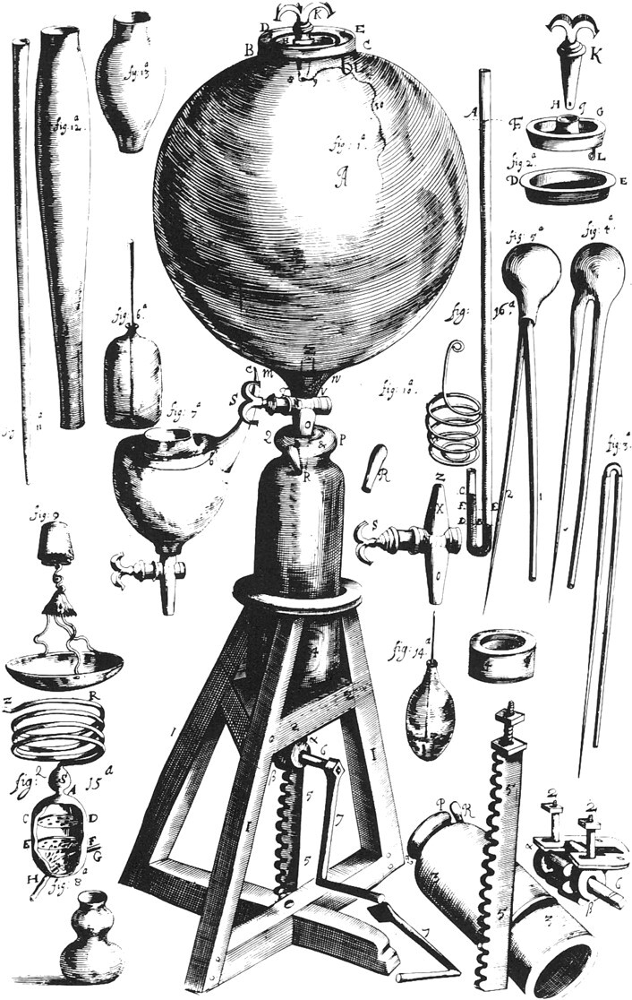

# The air pump

| | |
|---|---|
| **First made** | In Oxford in 1659, built by Hooke for Boyle |
| **Made of** | A glass globe, a brass cylinder and piston, a wooden stand |
| **What it does** | Draws the air out of the globe, a little at each stroke |
| **Before it** | Guericke's pump of the 1650s, worked by two men for hours |
| **After it** | Hauksbee's pump with two cylinders, about 1709 |

## Why it mattered

The pump worked in a cycle. With the stopcock shut, the handle wound the sucker down, leaving the cylinder empty. Opening the stopcock let part of the globe's air rush down into it. Then the stopcock was shut, the peg pulled out of the valve, and the sucker wound up again to push that air out. Each stroke took a share of what was left, so the air grew thinner and thinner.

Keeping the outside air from creeping back was the hard part. The sucker fitted so tightly that it had to be rammed into the cylinder. Boyle poured salad oil into the cylinder and the stopcock, and sealed the joints with cement. Even so, he wrote, the air was harder to keep out than anyone would imagine.

## The real thing

*Boyle's air pump, engraved for his book on the spring of the air, with its parts drawn apart around it. Engraving: public domain.*
