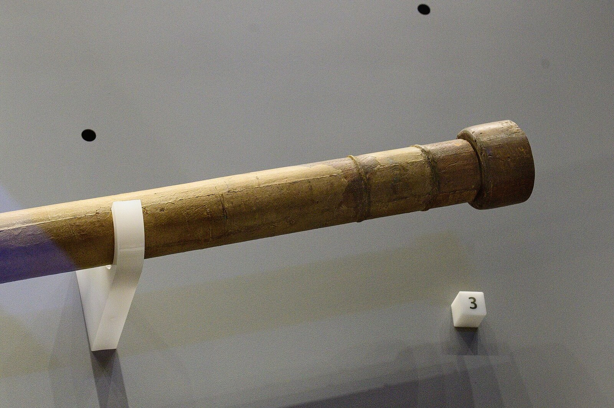

# The telescope

| | |
|---|---|
| **First made** | In the Netherlands in 1608. Galileo's own in 1609 |
| **Made of** | Two glass lenses in a paper-covered wooden tube |
| **What it does** | Makes far things look up to twenty times nearer |
| **Before it** | The naked eye, and brass sights for measuring angles |
| **After it** | Kepler's design of 1611, with two convex lenses |

## Why it mattered

On its own, the front lens would bring the light to a point more than a metre behind it. The concave lens catches the rays before they meet and sends them on side by side again, but spread at a wider angle, so everything looks larger. The power is the ratio of the two lenses' focal lengths. In one of Galileo's telescopes, 133 centimetres to 9.4 gives 14 times.

The price was a narrow view. The field was a quarter of a degree wide, about half the Moon, and finding a planet meant inching the tube across the sky. Kepler's design of 1611, with two convex lenses, showed far more at once but turned the picture upside down. Astronomers took it up, and Galileo's arrangement lived on in opera glasses.

## The real thing

*The front of a telescope Galileo made about 1610, of wood, paper and copper wire, in the Museo Galileo, Florence. Photo: Zde, CC BY-SA 4.0.*
