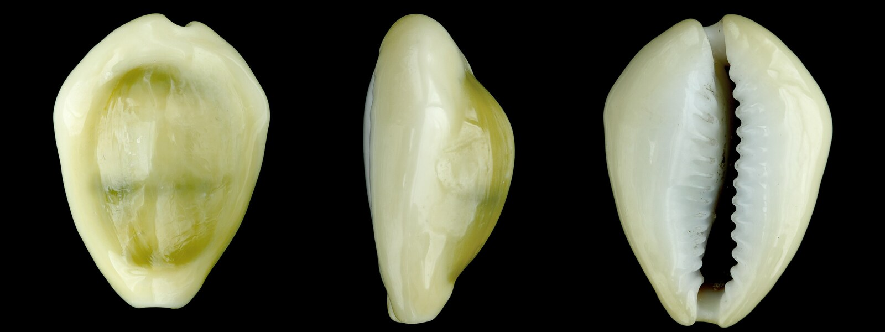

# The cowrie

| | |
|---|---|
| **First made** | In use as money in Mali by the 1350s |
| **Made of** | The shell of a small sea snail, fished in the Maldives |
| **What it does** | Gives a market small change that cannot be forged |
| **Before it** | Gold dust, salt, cloth and copper |
| **After it** | Cheaper East African shells from the 1840s, then coins |

## Why it mattered

A cowrie made sensible money. It could not be forged, it hardly wore out, and the shells were so alike in size that people counted them instead of weighing them. In Mali in the 1350s, the traveller Ibn Battuta found 1,150 of them buying a single gold coin, so they served for the smallest purchases in a market.

For Europeans the shells cost little to carry. Ships coming home from Asia held tea, silk and spices worth far more than the goods they had taken out, so the spare space in their holds was filled with cowries as ballast. Sold at auction, the shells went south again on the slave ships. At least 30 billion reached the Bight of Benin between 1500 and 1875.

## The real thing

*A money cowrie from above, from the side and from below. It is 2.6 centimetres long and comes from Indonesia. Photo: H. Zell, CC BY-SA 3.0.*
