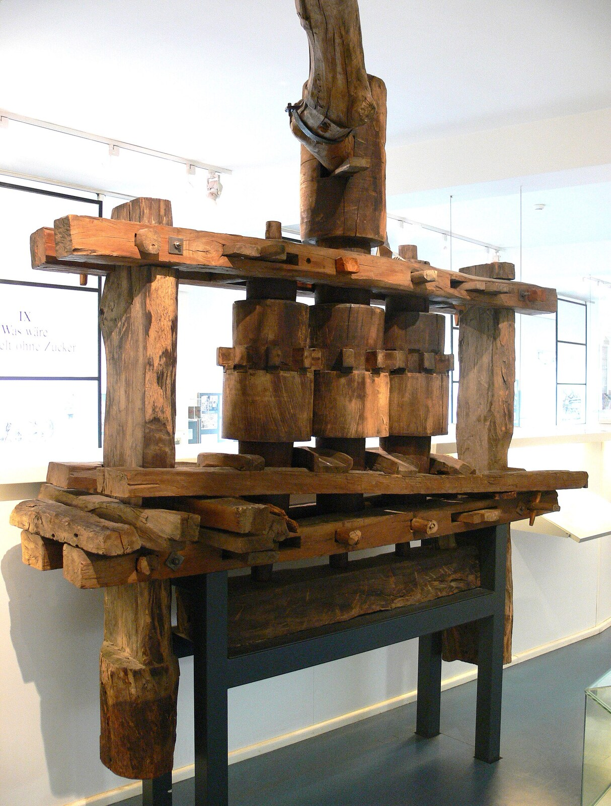

# The sugar mill

| | |
|---|---|
| **First made** | In South America by the early 1600s |
| **Made of** | Hardwood rollers in iron sleeves, with hardwood cogs |
| **What it does** | Squeezes the juice from cane, crushing each stalk twice |
| **Before it** | Two-roller mills, edge-runner stones and screw presses |
| **After it** | Steam engines and flat-laid iron rollers, in the 1800s |

![On the left, an ox walking away from the mill, dragging the end of a long sloping pole fixed to a tall shaft. The shaft rises from the middle of three red upright rollers, banded with iron, which stand in a wooden frame with cogs around their tops; a green stalk of cane is going in between the rollers. Below, a yellow gutter runs downhill from the bed of the mill to a boiling house with copper kettles over a fire. An inset shows the rollers from above, with the cane going in between the middle and right rollers, bending round the middle one and coming back out between the middle and left](sugar-mill.png)

## Why it mattered

The three-roller mill needed fewer hands than the presses before it. A worker pushed the stalks in between the middle roller and one side roller. On the far side a second worker caught the flattened canes and fed them back between the middle roller and the other. Each stalk was crushed twice in one go, and the sugar made per worker rose by at least half.

Everything else on an estate waited on the mill. A Barbados plantation manager wrote in 1657 that if a cog or a sweep broke, the whole work stood still. Later, many estates built windmills, which saved the cattle but stopped when the wind dropped. On St Croix, planters kept a cattle mill beside the windmill as a spare.

## The real thing

*A three-roller cane mill from Bolivia, all of wood, in the Sugar Museum in Berlin. The wooden cogs ring the rollers halfway up. Photo: FA2010, public domain.*
