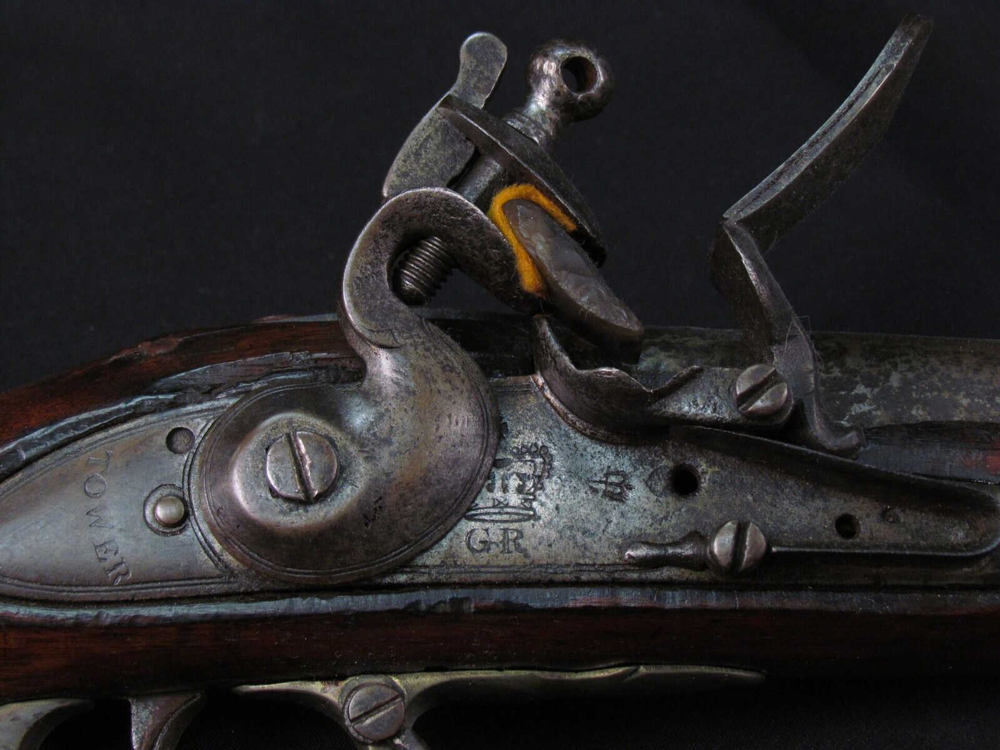

# The flintlock musket

| | |
|---|---|
| **First made** | France, about 1610; standard in most armies by 1700 |
| **Made of** | Iron barrel, wooden stock, steel lock gripping a flint |
| **What it does** | Strikes sparks into the powder at a pull of the trigger |
| **Before it** | The matchlock, with pikemen to guard the musketeers |
| **After it** | The percussion cap, in general use from about 1830 |

![Above, a long musket with a wooden stock and an iron barrel, its lock marked in red and ringed, and a socket bayonet fixed at the muzzle, the blade lying alongside the barrel. Below left, the lock enlarged: a red swan-necked cock pivoting on the lock plate holds a dark flint in its jaws, facing a tall red steel that stands over a small pan of powder, with sparks between them and a dashed line showing the cock's swing. Below right, three grey figures firing to the right in a line three deep, the front one kneeling, with smoke at the front muzzle](flintlock-musket.png)

## Why it mattered

The flint did away with the burning cord. A flintlock could be loaded about twice as fast as a matchlock, and it misfired far less often, so a line of men could keep up a steady fire.

The socket bayonet finished the change. The older plug bayonet was pushed into the muzzle, so the gun could not fire while it was fitted. The socket slid over the outside of the barrel, with the blade set to one side, and the soldier could load and fire with it in place. After 1697 the English and the Germans gave up the pike, and every foot soldier became his own pikeman. The Company armed its sepoys with a musket with a shorter barrel, which the British Army took up in the 1790s.

## The real thing

*The lock of an India Pattern musket, the British army's version of the Company's design. The flint is padded where the jaws grip it, and the steel stands open. Photo: Smithsonian Institution, public domain.*
