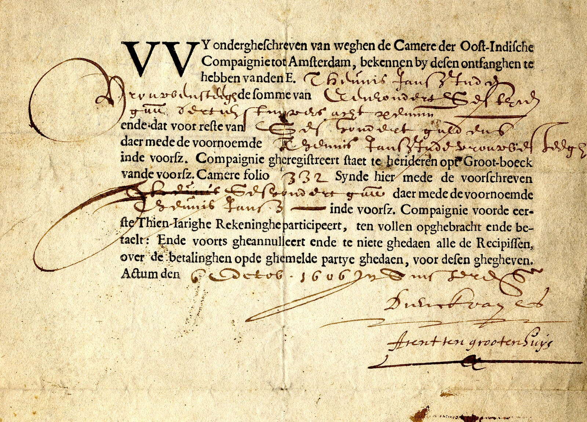

# The company share

| | |
|---|---|
| **First made** | Dutch East India Company, Amsterdam, 1602 |
| **Made of** | A line in the company's register; the owner held a receipt |
| **What it does** | Gives a slice of the profits, sized by the money put in |
| **Before it** | Partnerships for one voyage, closed when the ships returned |
| **After it** | Shares in banks, canals and railways, sold on exchanges |

![A diagram. On the left, five small figures each hand over a coin; dashed lines carry the coins into a large wooden chest in the middle. An arrow leads from the chest to a ship on a strip of sea, dashed arrows show the ship sailing to Asia and returning loaded with sacks, and another arrow brings money back to the chest. Below the chest, coins are shared out in stacks of different heights and an arrow carries them back to the investors. On the right, one figure hands a red paper to another, who pays him in coins](share.png)

## Why it mattered

A share was not a paper kept at home. The owner's holding was a line in the company's great book, and he kept only a receipt for what he had paid. To sell, he and the buyer went to the company's office, where two directors signed the change of owner into the book.

The owners waited eight years for any return. In 1610 the first dividend was paid not in money but in mace, a spice, worth three quarters of each stake. Shares could also be sold for later delivery, which made it possible to bet on a fall. In 1609 a group led by Isaac Le Maire, the largest of the first investors, did just that. The directors accused them of spreading rumours to drive the price down.

## The real thing

*A receipt from the company's Amsterdam office, 1606, for the last payment on a stake of 600 guilders. It names the page of the great book where the stake is entered. Photo: Amsterdam City Archives, public domain.*
