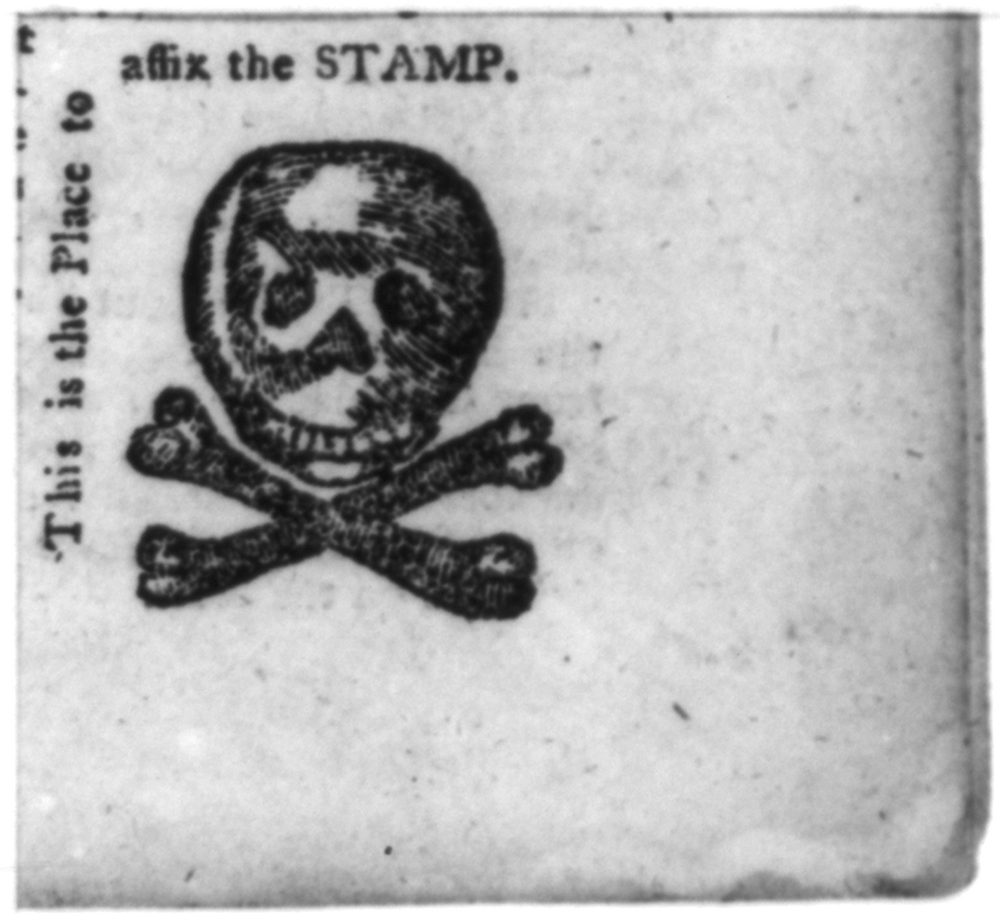

# The tax stamp

| | |
|---|---|
| **First made** | England, 1694; for the American colonies, 1765 |
| **Made of** | Paper or parchment, struck with an engraved die |
| **What it does** | Shows on the document itself that the tax was paid |
| **Before it** | Stamp duties voted by Massachusetts and New York, 1750s |
| **After it** | The United States' own stamp duty on documents, 1797 |

![On the left, a tall handwritten deed with a pale round stamp pressed into its top corner. In the middle, the stamp enlarged: a crown over a ring-shaped garter with a rose inside it, all raised in the paper with no ink, the word AMERICA above and II SHILLINGS VI PENCE below. At top right, the stamp being struck, seen edge on: a red die with hollows in its face above, the paper between, and a grey counter with matching bumps below, arrows pressing them together. At bottom right, a sheet of parchment with a square of blue paper fixed to it by a small metal staple, the stamp pressed into the blue paper](tax-stamp.png)

## Why it mattered

Most of the stamps were never stuck on anything. Blank sheets were stamped in London and shipped across the Atlantic, and in each colony a distributor sold them. The buyer then wrote his deed, bond or lease on the stamped sheet. The duty ran from a halfpenny on a small newspaper to ten pounds for a lawyer's licence, and it had to be paid in coin, which was scarce in America.

Parliament repealed the act on 18 March 1766, less than five months after it came into force, so most of the stamped paper was never sold. As a result, used stamps are rare. Nearly all of those that survive were used in what is now Canada.

## The real thing

*A Philadelphia newspaper, the Pennsylvania Journal, printed this skull and crossbones where the stamp would go, in October 1765. Woodcut: William Bradford, publisher, public domain.*
