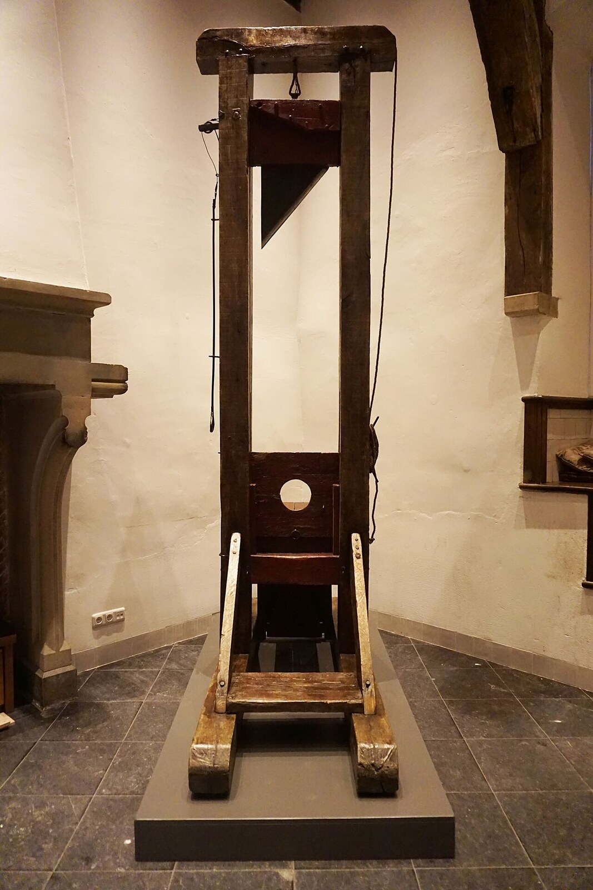

# The guillotine

| | |
|---|---|
| **First made** | Paris, 1792. First used on 25 April, on a highwayman |
| **Made of** | Oak posts, a slanted steel blade, a weight of lead or iron |
| **What it does** | Takes off a head in an instant, the same for everyone |
| **Before it** | Straight-bladed machines, like the Scottish Maiden |
| **After it** | Used in France until 1977; the death penalty ended in 1981 |

![Two views of the machine with no one in it. On the left, from the front: two tall oak posts on a platform, joined by a beam at the top with a pulley; between them hangs an iron weight with a red blade beneath it, its edge slanting steeply from one side to the other; a cord runs from a ring on the weight over the pulley and down the outside of a post to a cleat; near the bottom, two boards meet around a round hole, the collar. On the right, from the side: one post with the blade seen edge on, the collar at its foot, and a long flat plank on a frame with a pivot, reaching up to the collar](guillotine.png)

## Why it mattered

The design was drawn up by Antoine Louis, secretary of the Academy of Surgery, and for a few months it was called a louisette after him. Louis chose a slanted blade, which slices as it falls instead of chopping. A carpenter asked 5,660 livres to build the first one. Tobias Schmidt, a German who made harpsichords, built it for 824.

On 17 April 1792 the machine was tried on three corpses at the hospital of Bicêtre, outside Paris. The tilting plank was added after those trials. The condemned person was strapped to it standing, then tipped flat, so that the neck lay in the collar under the blade. Eight days later the guillotine was used on a living man.

## The real thing

*A guillotine made in France or Italy between 1800 and 1850, now in the Gevangenpoort museum in The Hague. The blade hangs raised between the posts. Photo: Rijksmuseum De Gevangenpoort, CC BY-SA 4.0.*
