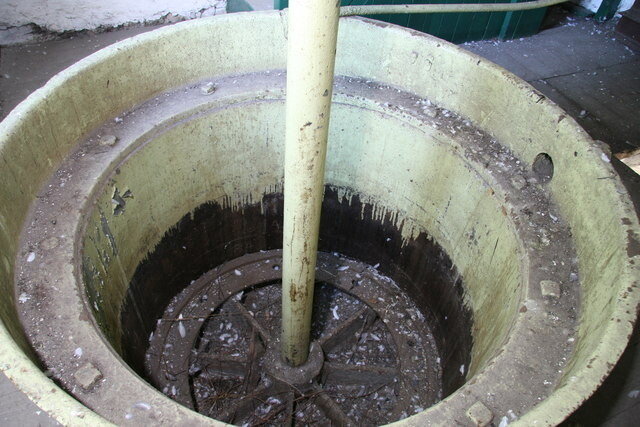

# The atmospheric engine

| | |
|---|---|
| **First made** | Near Dudley Castle, in the English Midlands, 1712 |
| **Made of** | A copper boiler, a brass cylinder, an oak beam, chains |
| **What it does** | Lets the air push a piston down, to work a mine pump |
| **Before it** | Horses winding up buckets, and Savery's steam pump |
| **After it** | Watt's engine with a separate condenser, from 1776 |

![A cut through a Newcomen engine. A copper boiler sits over a fire; above it a red cylinder, open at the top, holds a red piston with a thin layer of water on it. A jet of cold water from a pipe sprays into the bottom of the cylinder, fed from a tank high up. A chain runs from the piston to one end of a long wooden beam that pivots on top of a brick wall; from the other end a pump rod hangs down into a mine shaft, where water spills out at the surface. Arrows show the piston going down and the pump rod going up](atmospheric-engine.png)

## Why it mattered

The hardest part was keeping the air out. The cylinder was never bored truly round, so a ring of leather on the piston could not seal it alone. A layer of water was kept standing on top of the piston to fill the gaps. A small valve let out the air that came in with the steam, which would otherwise have choked the engine.

The engine also worked its own valves. A rod hung from the beam beside the cylinder, and pegs on it opened and shut the steam and water taps as the beam rose and fell. Until 1733, Newcomen and his partners had to work under another inventor's patent, which covered any engine that raised water by fire.

## The real thing

*The open top of the cylinder of the engine at Elsecar, near Barnsley, which pumped a coal mine from 1795 to 1923. Photo: Chris Allen, CC BY-SA 2.0.*
