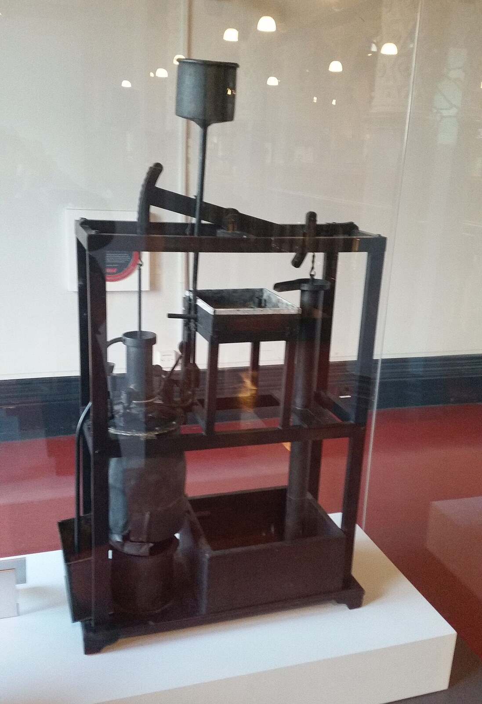

# The separate condenser

| | |
|---|---|
| **First made** | Glasgow, 1765; patented 1769; first sold in 1776 |
| **Made of** | A chamber kept in cold water, piped to the cylinder; a pump |
| **What it does** | Condenses the steam away from the cylinder, which stays hot |
| **Before it** | Newcomen's engine, cooled inside its own cylinder |
| **After it** | High-pressure engines with no condenser, from about 1800 |

## Why it mattered

Watt said the idea came to him on a Sunday walk across Glasgow Green in 1765. The condenser alone was not enough. Water from the condensed steam, and air that leaked in, collected inside it and would soon have spoiled the vacuum, so a small pump worked by the beam drew them off at every stroke.

Watt also closed the top of the cylinder. In Newcomen's engine the cool air of the engine house pressed the piston down, and chilled the cylinder as it did so. In Watt's, steam from the boiler did the pressing, and a jacket of steam around the cylinder kept it hot from outside.

## The real thing

*The model Newcomen engine that Glasgow University gave Watt to repair in 1763 or 1764. It is now in the Hunterian Museum, Glasgow. Photo: Andy Dingley, CC BY-SA 4.0.*
