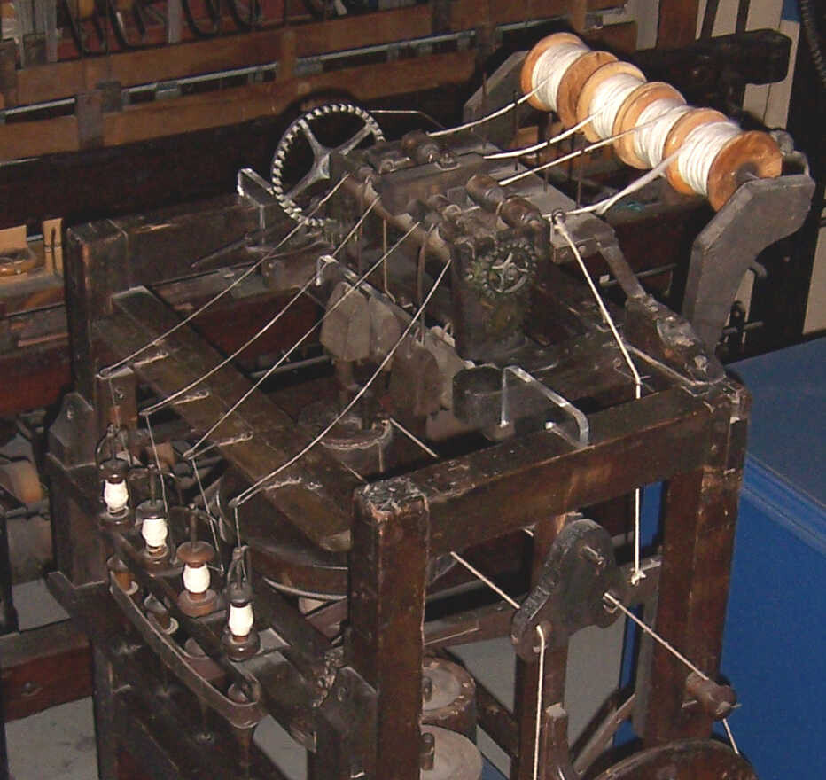

# The water frame

| | |
|---|---|
| **First made** | Nottingham, 1769, driven by horses; Cromford, 1771 |
| **Made of** | Wooden frame, metal gears, fluted and leather-covered rollers |
| **What it does** | Draws cotton out thin and twists it into strong thread |
| **Before it** | The spinning wheel, and the jenny of the 1760s |
| **After it** | Crompton's mule, 1779, which spun finer thread |

## Why it mattered

The rollers did what a spinner's fingers had done. Each pair gripped the cotton, and the next pair, turning faster, pulled the fibres past one another so the strand grew longer and thinner. On a surviving frame of 1775, the last pair turns more than eighteen times as fast as the first.

The thread came out coarse but strong. British weavers had made cotton cloth on a warp of linen, because hand-spun cotton was too weak to stretch on the loom. From 1773 Arkwright used his thread for the warp as well, and cloth made wholly of cotton was woven in England. In 1785 a court cancelled his patent, and anyone could build the machine.

## The real thing

*A water frame made in 1775, in the Science and Industry Museum, Manchester. Photo: Chris55, CC BY 3.0.*
