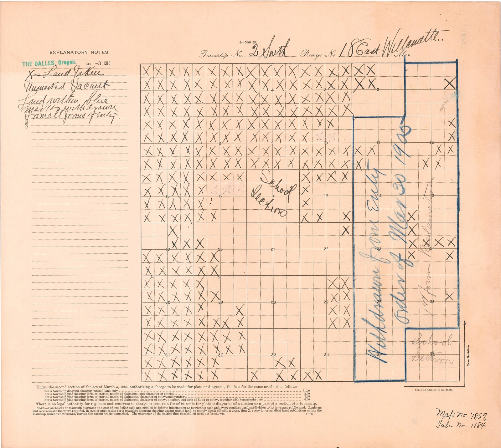

# The survey grid

| | |
|---|---|
| **First made** | Eastern Ohio, 1785: the Seven Ranges |
| **Made of** | Lines run with compass and chain, marked by posts and mounds |
| **What it does** | Cuts land into numbered squares, to be sold from a map |
| **Before it** | Plots traced by trees, rocks and streams |
| **After it** | Carried west to the Pacific, and copied in Canada |

## Why it mattered

Every square had an address. Townships were counted north or south from an east-west base line, and east or west from a north-south meridian, so a farm could be named in a short line of numbers. Inside each township, the sections were numbered back and forth, the way an ox ploughs a field.

The surveyors measured with Gunter's chain, 66 feet long and made of 100 iron links. Eighty chains made a mile, and ten square chains made an acre. Lines running due north close in on one another, because the Earth is round, so every four or five townships the surveyors started the squares afresh. North-south country roads still jog sideways where they cross one of these correction lines.

## The real thing

*A land-office plan of one township in Oregon, marked up in the early 1900s. Each X is land already claimed; sections 16 and 36 are school land. Map: US Land Office, public domain.*
