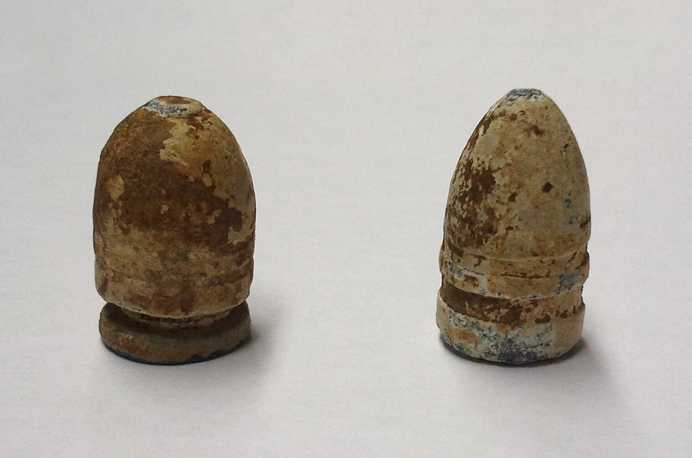

# The Minié ball

| | |
|---|---|
| **First made** | France, 1849, by the army officer Claude-Étienne Minié |
| **Made of** | Soft lead, cast with a hollow base and grease grooves |
| **What it does** | Loads as fast as a musket ball, and fires true from a rifle |
| **Before it** | Round balls: quick in smoothbores, slow to force into rifles |
| **After it** | Metal cartridges and rifles loaded at the breech |

![Above, a long rifle barrel cut open to show diagonal grooves inside it, with powder at the breech end and a red bullet, narrower than the bore, being rammed down from the muzzle. Below left, a red bullet cut in half: a pointed nose, three grooves round the body, and a cone-shaped hollow in its base. Below centre, the bullet in the barrel at the moment of firing, with arrows of gas from the burning powder pushing into the hollow and spreading the base into the grooves. At the bottom, two bars compare how far each weapon could hit a man: a short pale bar for the smoothbore musket ending near 90 metres, a long dark bar for the rifle musket ending near 250](minie-ball.png)

## Why it mattered

The first version had an iron cup pushed into its base, which drove the lead outward when the gun fired. In 1855 James Burton, at the American armory at Harpers Ferry, made the hollow deeper and left the cup out. The gas alone now spread the base, and the bullet became lighter and cheaper to make.

It was also a terrible thing to be hit by. A round musket ball often stopped inside the body. The Minié ball usually went straight through, and when it struck a bone it shattered it, so that surgeons in the Civil War often had no choice but to cut off the arm or leg.

## The real thing

*Two lead bullets of the American Civil War. The rings near the base of the right one held grease. Photo: Onetuc, CC0.*
