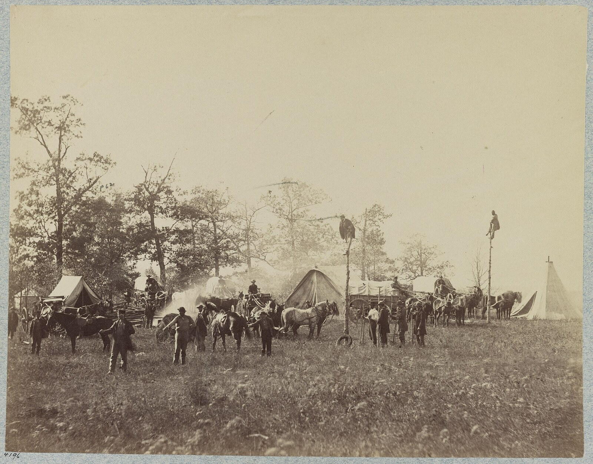

# The telegraph

| | |
|---|---|
| **First made** | England, 1838; Samuel Morse's line in America, 1844 |
| **Made of** | A battery, a key, a wire on poles, an electromagnet |
| **What it does** | Sends a message along a wire as fast as a hand can tap |
| **Before it** | Riders, and signal towers in sight of one another |
| **After it** | A cable under the Atlantic, 1866; the telephone, 1876 |

![On the left, three glass jars of a battery with metal plates in them, and beside them a telegraph key: a brass lever on a pivot, with a black knob at the front over a contact. A wire runs from the key up a wooden pole, across to a second pole, and down to a sounder on the right: two red coils of an electromagnet with an iron bar above them, fixed under a brass lever pivoted at the back. Wires from the battery and from the sounder run down to metal plates buried in the ground. Along the bottom, dots and dashes spell the letters S E N D and M E N](telegraph.png)

## Why it mattered

The first public message went from Washington to Baltimore on 24 May 1844: "What hath God wrought". The early receivers marked dots and dashes on a moving paper tape. From 1848 some operators began to read the clicks by ear instead, and in time a simple sounder replaced the tape.

In the Civil War the Union's military telegraph strung more than 15,000 miles of line, much of it behind armies on the move. Most of its 1,500 men were civilian operators without military rank, and important messages went in cipher. The operators worked close to the fighting, and about one in ten of them was killed, wounded or captured.

## The real thing

*The Union army's telegraph construction corps in camp, with linemen at the tops of new poles. From Alexander Gardner's photographic sketch book of the war, 1866. Public domain.*
