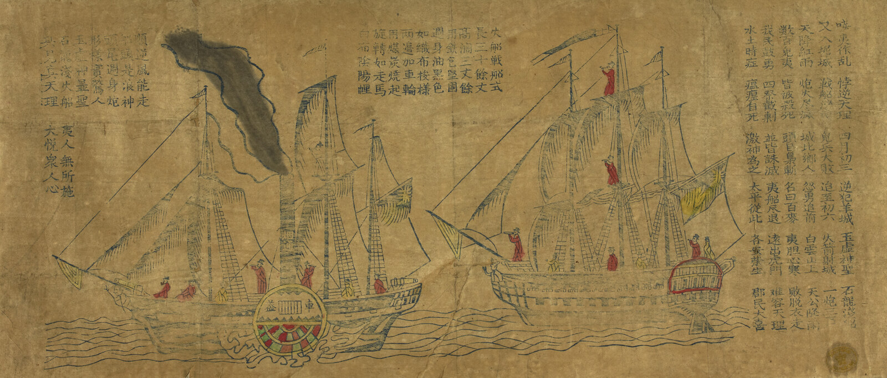

# The iron steamship

| | |
|---|---|
| **First made** | Birkenhead, England, 1839, in John Laird's yard |
| **Made of** | Riveted iron plates; steam engines and paddle wheels |
| **What it does** | Goes up shallow rivers, against the wind and the current |
| **Before it** | Wooden sailing warships, which needed deep water and wind |
| **After it** | Armoured iron warships with propellers, from 1860 |

![A long, low ship seen from the side, floating in a shallow river with the riverbed just below her. Her grey iron hull is marked with rows of rivets and the seams of its plates, and dashed white lines inside it mark the iron walls that divide it into compartments. Amidships a red paddle wheel turns half under a curved paddle box, with a tall black funnel trailing smoke behind it. Two masts carry fore-and-aft sails. A heavy gun sits on a turning mount at the bow and another at the stern. A measuring line shows the hull reaching less than two metres below the waterline, and a line beneath shows her length, 56 metres](iron-steamship.png)

## Why it mattered

The *Nemesis* was built in about three months for the East India Company's Secret Committee, and she never appeared in the company's list of ships. Sailing out to the East in 1840, she became the first iron ship to round the Cape of Good Hope.

Iron brought problems that wood never had. The hull pulled her compass needle off true. Magnets were fixed near it to correct the error, by a method that the Astronomer Royal, George Airy, had worked out the year before, but her compass stayed unreliable all her life. On the other hand, iron could be divided by watertight walls, the first in any warship. They helped her survive damage to her hull, once on her trials and again on the voyage out.

## The real thing

*A Chinese print of the Nemesis, left, with her paddle wheel and smoking funnel, beside a British sailing warship. The columns of characters are a poem. Artist unknown, public domain.*
