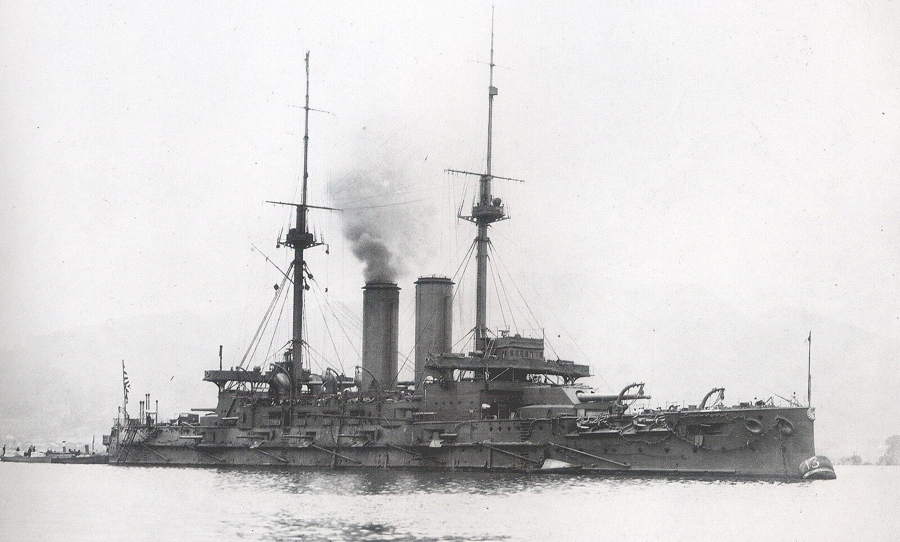

# The battleship

| | |
|---|---|
| **First made** | Britain, 1891; Mikasa built at Barrow for Japan, 1902 |
| **Made of** | A steel hull, hardened steel armour, coal-fired engines |
| **What it does** | Fires the heaviest shells from behind thick armour |
| **Before it** | Ironclads: steam warships plated with iron, from 1859 |
| **After it** | HMS Dreadnought, 1906: ten big guns and turbine engines |

## Why it mattered

Japan could not yet build ships like her, so it bought them in Britain. The *Mikasa* cost £880,000 and took three years to build at Barrow. Her bunkers held up to 2,000 tons of coal, enough to steam about 9,000 nautical miles at an easy speed.

At Tsushima she led the Japanese line and drew most of the Russian fire. She was hit more than forty times, ten of them by 12-inch shells, and kept fighting. That September, at anchor in Sasebo, a fire set off one of her magazines and sank her, killing 251 men, more than twice her losses in the battle. She was raised and served until 1923. Today she sits in concrete at Yokosuka as a memorial.

## The real thing

*The Mikasa at anchor at Kure, Japan, in her years of service. Her two funnels stand between the masts. Photo: unknown, public domain.*
