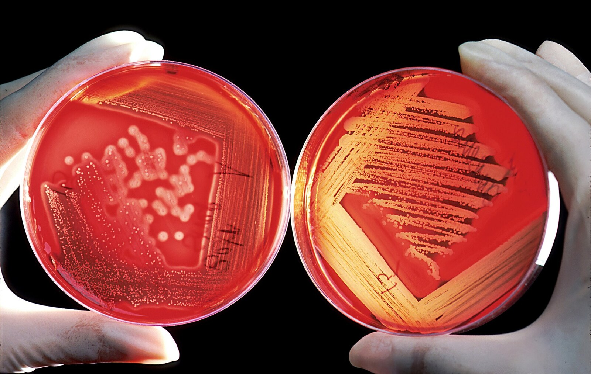

# The Petri dish

| | |
|---|---|
| **First made** | Berlin, 1887, by Julius Petri, an assistant of Robert Koch |
| **Made of** | Two shallow glass dishes, one the lid; a layer of agar |
| **What it does** | Holds a firm jelly on which each germ grows into a spot |
| **Before it** | Glass slides or plates coated with jelly, in a damp box |
| **After it** | Throwaway plastic dishes, common from the 1960s |

## Why it mattered

Koch's laboratory first grew germs on gelatin, which failed in two ways. It melted at the warmth of the body, which is where disease germs grow best, and some germs digested it and turned it to liquid. In 1881 Fanny Hesse, whose husband worked for Koch, suggested agar, a jelly made from seaweed. She had learned of it from friends of her mother who had lived in the East Indies. Agar stays solid up to about 85 °C, and few germs can eat it.

The dish saved steps. The jelly was poured hot straight into it and set, and the sample was spread across it. With its lid on, or turned upside down, the dish kept falling dust out while the germs grew.

## The real thing

*Two dishes of agar mixed with blood, streaked with bacteria. Where the streaks thin out, each germ has grown into its own spot. Photo: Bill Branson, National Cancer Institute, public domain.*
