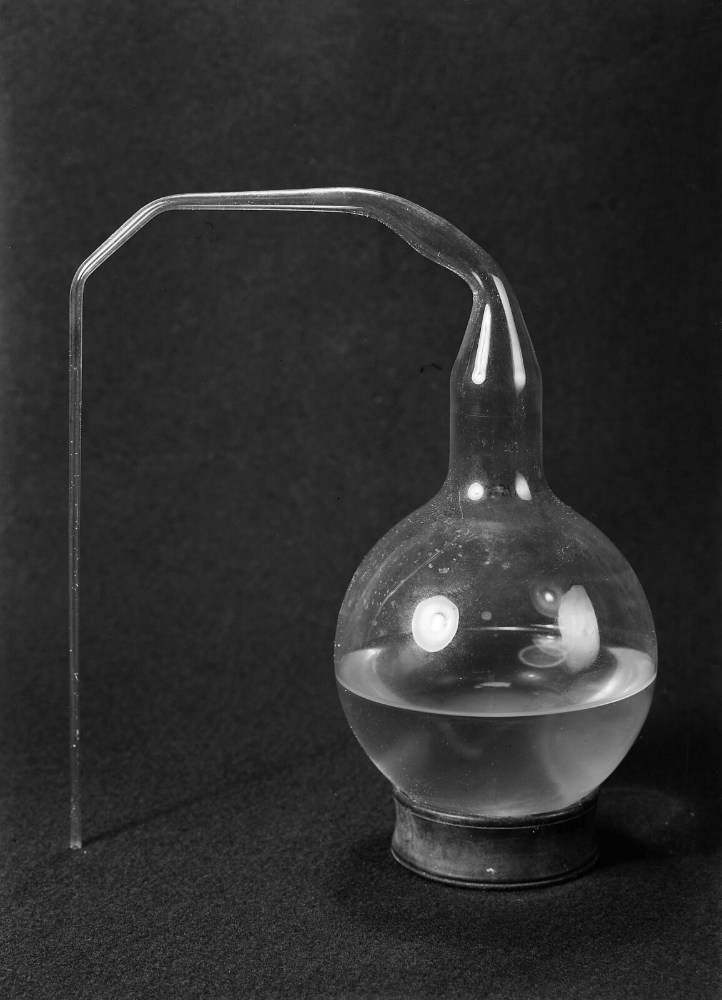

# The swan-neck flask

| | |
|---|---|
| **First made** | Paris, about 1860, by the chemist Louis Pasteur |
| **Made of** | A glass flask, its neck softened in a flame and bent |
| **What it does** | Lets air reach a boiled broth but keeps out the dust |
| **Before it** | Sealed flasks, which left open whether life needed air |
| **After it** | The autoclave, built by Pasteur's assistant in 1879 |

## Why it mattered

The flasks were one part of a campaign. In 1860 Pasteur also carried sealed flasks of boiled broth to different places and opened them for a moment. In the courtyard of the Paris Observatory, all eleven he opened went cloudy. On the Mer de Glace, a glacier in the Alps, only one in twenty did. The farther from towns, the fewer germs the air carried.

The French Academy of Sciences had offered a prize of 2,500 francs to whoever could settle the question of spontaneous generation. Pasteur's rival, the naturalist Félix Pouchet, believed that life did arise by itself. He refused to accept Pasteur's evidence, but he withdrew from the contest, and in 1862 the prize went to Pasteur.

## The real thing

*A flask used by Pasteur in the same experiments. Its neck is bent twice at right angles instead of into a curve, to the same end. Photo: Wellcome Collection, CC BY 4.0.*
