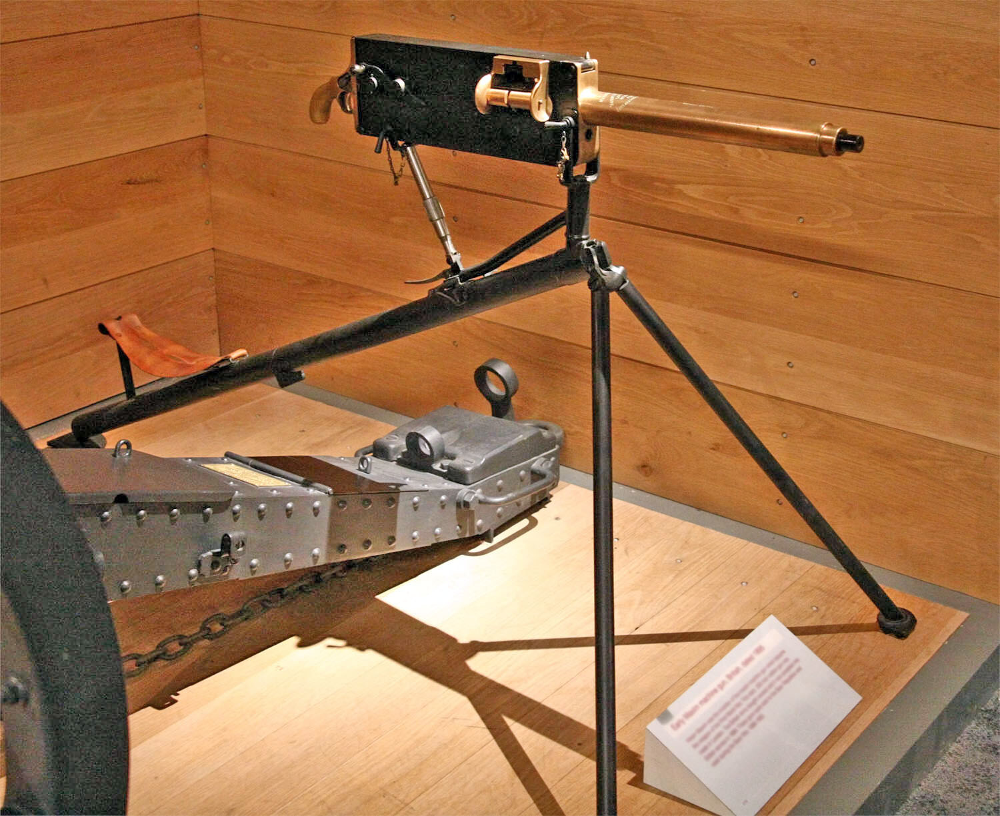

# The Maxim gun

| | |
|---|---|
| **First made** | London, 1884, by the American inventor Hiram Maxim |
| **Made of** | Steel and brass, a jacket of water, a cloth belt of rounds |
| **What it does** | Fires about 600 shots a minute while the trigger is held |
| **Before it** | Hand-cranked guns with several barrels, like the Gatling |
| **After it** | The Vickers gun, a redesigned Maxim, from 1912 |

![A machine gun on a tripod, seen from the side. A long pale cylinder of water surrounds the barrel, with a filler cap on top and the muzzle poking out of the front. Behind it is a dark box, the receiver, with a red panel showing the lock inside, a crank handle below and two grips and a trigger at the back. A cloth belt studded with brass cartridges runs up from an ammunition box on the ground into the top of the gun. In a framed panel at the right, two small diagrams: at the shot, the red lock sits against the rear of the barrel with a straight toggle behind it; a moment later, the toggle has folded down at its joint, the lock has moved back, and it carries a new cartridge above and an empty case below](maxim-gun.png)

## Why it mattered

Maxim took out his first British patents in 1883 and showed the gun to invited guests the following year. In trials it fired about 600 rounds a minute, as much as sixty riflemen of the day. However, it was no weapon for one man. The gun alone weighed about 27 kilograms, and a crew of four to six carried it, its water and its ammunition.

The first unit to receive one was a German expedition in East Africa in 1888. In 1893 the British South Africa Company used it on a large scale against the Ndebele kingdom, in what is now Zimbabwe. In a satirical poem of 1898, Hilaire Belloc put the arithmetic in two lines: "Whatever happens, we have got / The Maxim gun, and they have not."

## The real thing

*A .303 Maxim gun, the Extra-Light Model of 1895, at the former Royal Artillery Museum in Woolwich, London. Photo: Max Smith, public domain.*
