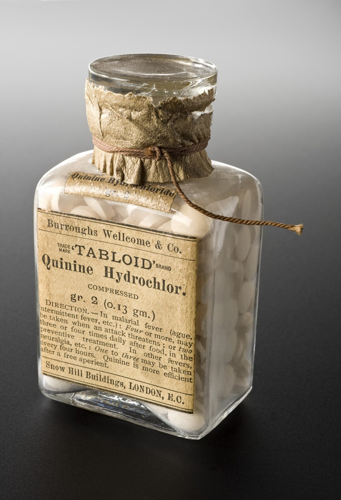

# Quinine

| | |
|---|---|
| **First made** | Paris, 1820, by the chemists Pelletier and Caventou |
| **Made of** | A bitter white powder drawn out of cinchona bark |
| **What it does** | Kills the malaria parasite while it lives in the blood |
| **Before it** | Ground cinchona bark, the "Jesuits' bark" of the 1600s |
| **After it** | Chloroquine and other man-made drugs, after 1945 |

## Why it mattered

The bark came from wild trees in the Andes. In 1865 Manuel Incra Mamani, an Indigenous seed hunter, gathered seeds of a rich kind for an English trader, Charles Ledger, and the Dutch government bought them. On a later trip Mamani was arrested and beaten so badly that he died. By the 1930s Dutch plantations in Java grew 97 per cent of the world's quinine.

Malaria is caused by a tiny parasite that mosquitoes carry. It hides first in the liver, then multiplies inside red blood cells, bursting out in waves that bring on the fever. Quinine kills it in the blood, not in the liver. A daily dose therefore kept the illness down; it did not stop the infection.

## The real thing

*A bottle of quinine tablets made in London by Burroughs Wellcome and Company. The label gives doses for malarial fever. Photo: Wellcome Collection, CC BY 4.0.*
