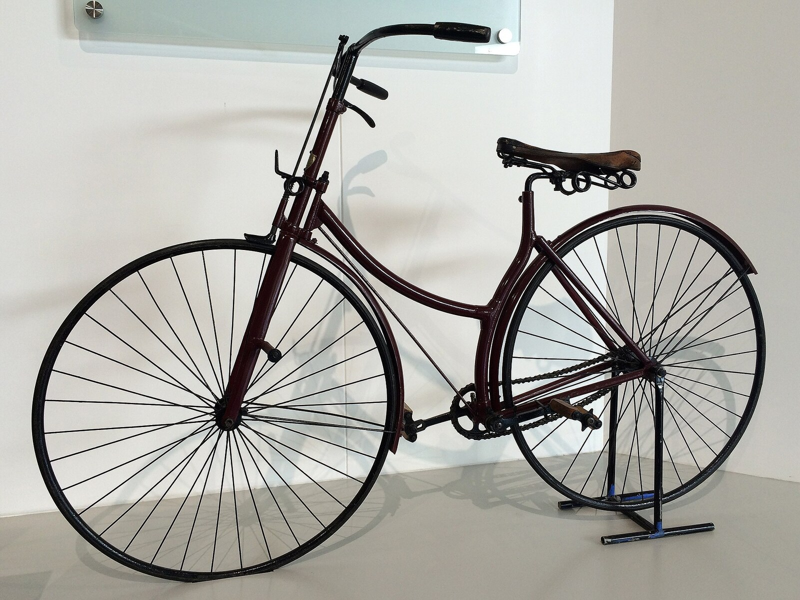

# The safety bicycle

| | |
|---|---|
| **First made** | Coventry, 1885: John Kemp Starley's Rover |
| **Made of** | Steel tubes, a chain, wire-spoked wheels, air-filled tyres |
| **What it does** | Carries a rider fast, low enough to put a foot down |
| **Before it** | The penny-farthing, pedalled at the hub of a huge wheel |
| **After it** | Little change: most bicycles still have this shape |

## Why it mattered

On a penny-farthing, one turn of the pedals turned the front wheel once, so a faster machine needed a bigger wheel, up to 1.5 metres across. The rider sat high over it, and a sudden stop threw him head first over the handlebars. The chain did the same job with a small wheel: with a big ring at the pedals and a small one at the back, every turn of the pedals turned the back wheel two or three times.

The early safeties ran on solid rubber and shook their riders hard. In 1888 John Boyd Dunlop, a Belfast vet, patented a tyre filled with air, first made for his son's tricycle. In May 1889 a rider on Dunlop's tyres won all four cycle races at a Belfast sports meeting.

## The real thing

*A Rover safety bicycle of 1886, made by Starley in Coventry, now in the British Motor Museum. Its front wheel is still a little larger than the back. Photo: Karen Roe, CC BY 2.0.*
