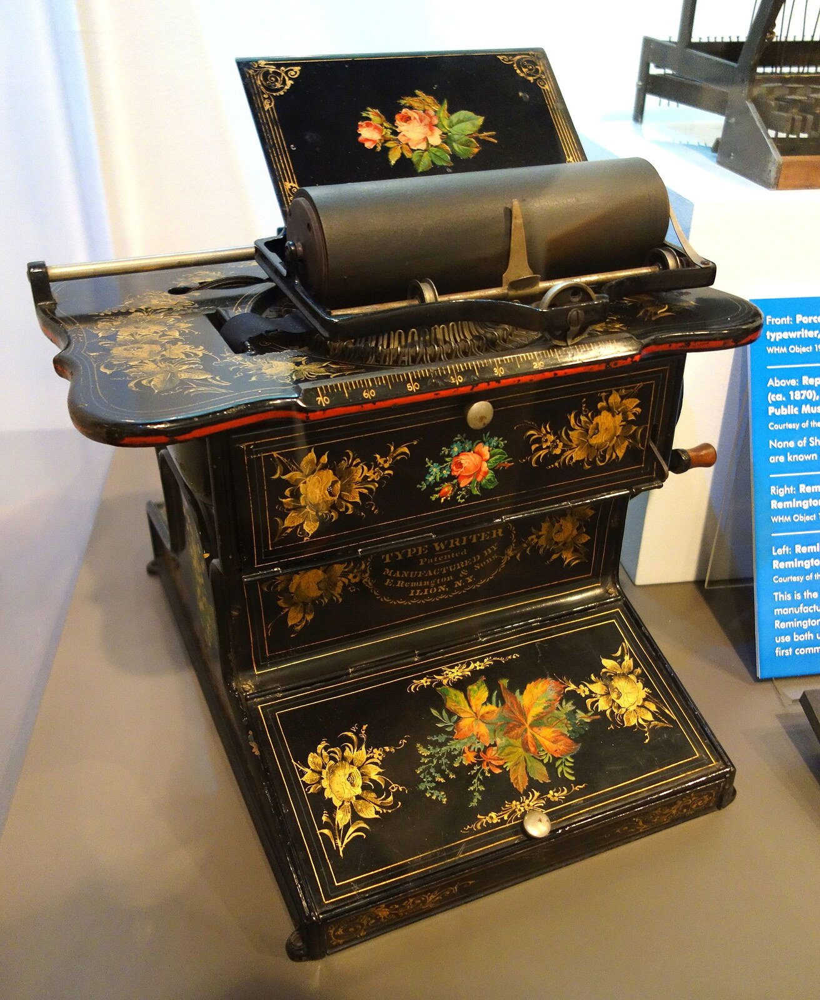

# The typewriter

| | |
|---|---|
| **First made** | Ilion, New York, 1874: the Sholes and Glidden, by Remington |
| **Made of** | Steel levers and type bars, an inked ribbon, a carriage |
| **What it does** | Prints a clean letter at each touch of a key |
| **Before it** | Clerks copying letters and accounts by hand with a pen |
| **After it** | Machines that let the typist see the line, from 1896 |

![Three drawings. At top left, the letter keys seen from above, round buttons in three staggered rows: Q W E R T Y U I O P, then A S D F G H J K L, then Z X C V B N M. At top right, the carriage from above: a frame holding a black roller with a sheet of paper on it, a spring drum at its right end, and an arrow pointing left marked one space after each letter. Below, the inside of the machine from the side: a key on a long lever, a wire running back from it to a ring of type bars, and one red type bar swung up so that the type on its end strikes, through a purple ribbon, the underside of the roller](typewriter.png)

## Why it mattered

The first machine cost about $125, roughly a year's average income, and it typed capital letters only. About 400 sold in its first six months. The buyers were mostly authors, clergymen, lawyers and editors. Mark Twain was one of the first. Small letters arrived with a second model in 1878.

The bars struck the paper from underneath, so the typist could not see the words as she typed them. Sholes had begun with the keys in alphabetical order. He rearranged them by trial and error, and Remington later swapped two more, which gave the order still in use. The case was painted with flowers, like the sewing machines that Remington also made.

## The real thing

*A Remington No. 1, the Sholes and Glidden model made at Ilion between 1873 and 1878, in the Wisconsin Historical Museum. Photo: Daderot, CC0.*
