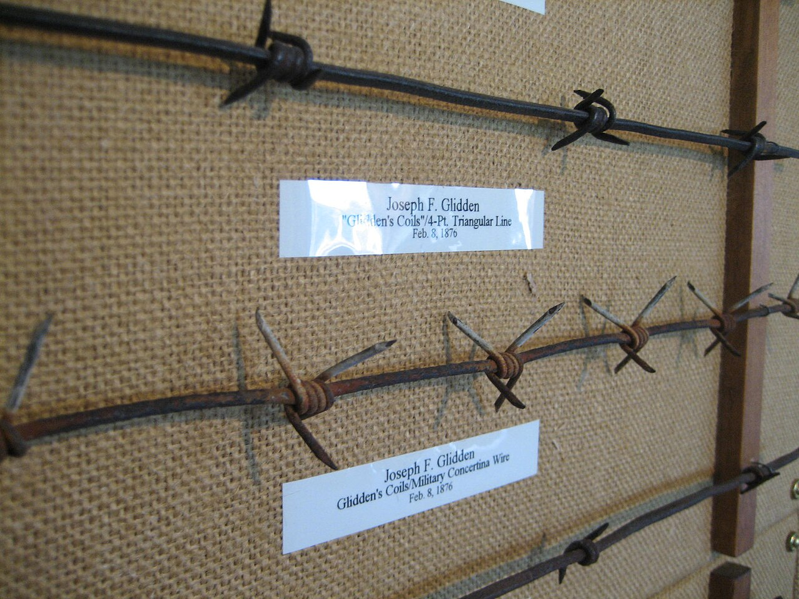

# Barbed wire

| | |
|---|---|
| **First made** | DeKalb, Illinois, 1874, by the farmer Joseph Glidden |
| **Made of** | Two strands of wire twisted together, and short wire barbs |
| **What it does** | Fences land with wire alone, where wood and stone are scarce |
| **Before it** | Rail fences, stone walls and hedges of thorny Osage orange |
| **After it** | Razor wire, edged with blades instead of barbs |

## Why it mattered

Glidden made his first barbs with a coffee mill and twisted the wires together with a grindstone. In 1874 about 10,000 pounds of his wire were made, mostly by hand. By 1880 Americans were buying more than 80 million pounds a year, and the open cattle range of the West was being cut up into fenced ranches.

The war asked more of it. Military entanglements had barbs set close together, strung on pickets in broad belts. Shrapnel shells had to burst at exactly the right moment to cut the strands, and often they did not. From 1917 British shells carried a new fuze that went off at the touch of a single wire.

## The real thing

*Two barbed wires that Joseph Glidden patented in 1876, in the Barbed Wire History Museum at DeKalb, Illinois. Photo: A. McMurray, CC BY 2.5.*
