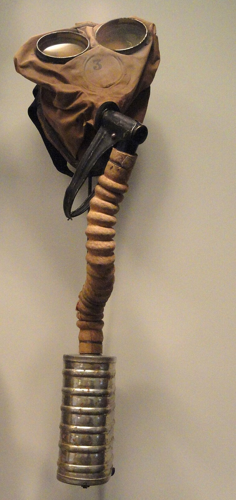

# The gas mask

| | |
|---|---|
| **First made** | Britain, 1916: the small box respirator, by a team led by the chemist Edward Harrison |
| **Made of** | Rubberised cloth, glass eyepieces, a hose, and a tin box of charcoal and lime |
| **What it does** | Lets a soldier breathe clean air inside a cloud of chlorine or phosgene |
| **Before it** | Cloth hoods soaked in chemicals and pulled over the head |
| **After it** | Masks for whole nations: Britain gave out 38 million by 1939 |

![Two drawings. At left, a soldier in a steel helmet seen from the side, wearing a khaki cloth facepiece with a round glass eyepiece. A clip pinches his nose inside the mask, and a mouthpiece sits in his mouth. A brass tube comes out under the chin, with a short black rubber flap hanging from it, and a ribbed hose runs down from it to a canvas bag on his chest. At right, the tin box from the bag, cut open: three stacked layers, dark charcoal above and below and a red layer of granules between, with an arrow showing air entering at the bottom and leaving at the top for the hose](gas-mask.png)

## Why it mattered

The hoods before it worked by soaking the cloth itself in chemicals, and each new gas meant a new mixture and a new hood. A box could hold layers of charcoal and granules that stopped a wide range of gases at once. It came in six sizes, and each man had to be fitted for his own.

It was hard to live in. Breathing through the teeth with the nose clipped shut was tiring, and the eyepieces misted over. Even so, when the Americans arrived in 1917, they ordered British masks and then made their own copy. Harrison died of pneumonia in November 1918, his lungs weakened by the gases he had breathed while testing.

## The real thing

*A British small box respirator, size 3, with its hose and tin filter box, in the National World War I Museum, Kansas City. Photo: Daderot, public domain.*
