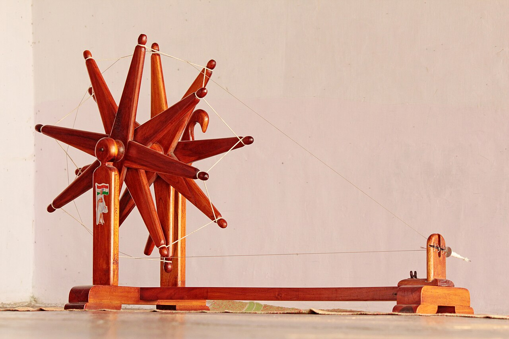

# The spinning wheel

| | |
|---|---|
| **First made** | India, by the 1300s, and revived by Gandhi's movement from 1918 |
| **Made of** | Wood and cord, with a steel spindle |
| **What it does** | Twists cotton fibres into thread, much faster than a hand spindle |
| **Before it** | The hand spindle, twirled with the fingers |
| **After it** | The box charkha of the 1930s, which folded into a case the size of a briefcase |

![A wooden spinning wheel seen from the side. At the right, a big wheel stands on two posts on a long low plank. Its spokes are tied to one another with cord, which makes a light rim, and a wooden handle sticks out from its centre. A thin cord band runs from the rim to a small pulley on a red spindle, which lies on top of a short post at the left end of the plank. A wisp of cotton trails from the spindle's point. A magnified circle at the upper left shows the spindle: the pulley at one end, a roll of finished thread wound on the middle, and a fine thread twisting off the sharp point towards a tuft of cotton](spinning-wheel.png)

## Why it mattered

Gandhi praised hand spinning in a book of 1909 as the cure for India's poverty, though he had never seen a spinning wheel. In 1917 a widow, Gangabehn Majmudar, promised to find one for him. She found them at Vijapur, a village in Baroda state, put away in lofts. The women there agreed to spin again if someone supplied them with carded cotton and bought their yarn.

From 1921 a spinning wheel stood at the centre of the Congress flag, and it stayed there until independence. In 1947 the new national flag replaced it with the wheel of Ashoka, an emperor of the third century BC. Gandhi was unhappy, and Nehru assured him that the new wheel stood for his spinning wheel too.

## The real thing

*A charkha of the kind Gandhi used, on display at the Sabarmati Ashram in Ahmedabad, where he lived from 1917 to 1930. Photo: Jigar Brahmbhatt, CC BY-SA 3.0.*
