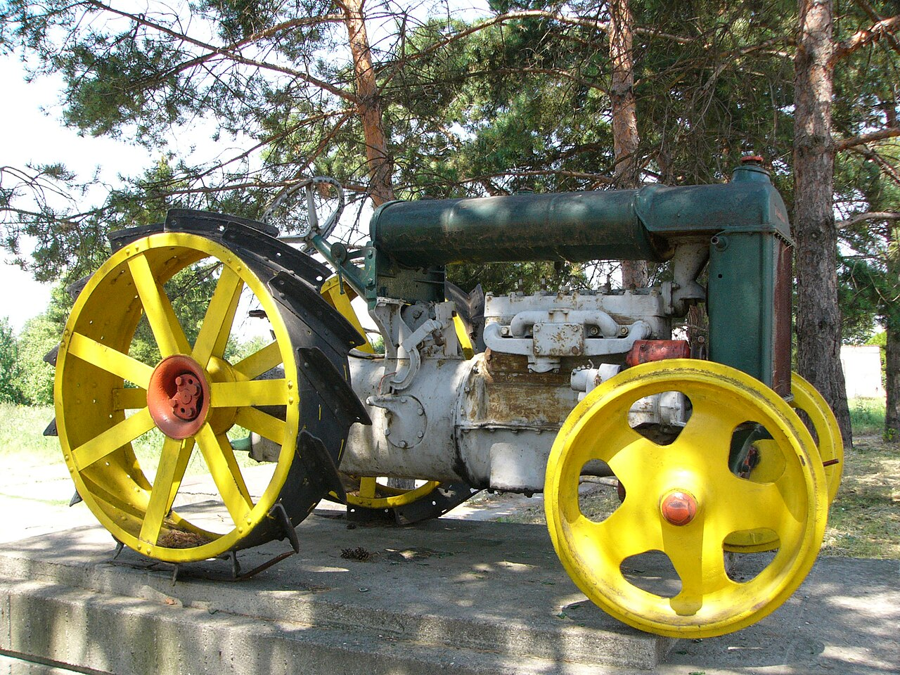

# The tractor

| | |
|---|---|
| **First made** | Dearborn, Michigan, 1917: the Fordson, by Henry Ford and Son; copied in Leningrad from 1924 |
| **Made of** | Cast iron and steel, on steel wheels |
| **What it does** | Pulls a plough or a harvester in place of a team of horses |
| **Before it** | Horses and oxen, and a few heavy steam tractors |
| **After it** | Tractors built at Stalingrad from 1930, copied from another American design |

## Why it mattered

The Fordson was cheap because it was built like a car. Ford's engineers did away with the frame, so that the castings themselves carried the load, and in 1922 the price fell to $395. In the 1920s the Soviet Union bought more than 25,000 of them, and from 1924 the Red Putilov works in Leningrad made a copy.

Lenin had said in 1919 that a hundred thousand good tractors would win the peasants over to communal farming. In 1928 the whole country had about 27,000. Under collectivisation they were kept at state machine-tractor stations, which hired them to the collective farms for a share of the grain. There were too few to replace the horses that the peasants had slaughtered.

## The real thing

*A Fordson Model F on a plinth in the Czech Republic, its wheels repainted yellow. The engine, gearbox and back axle form one long body, with no frame. Photo: Michal Maňas, CC BY 4.0.*
