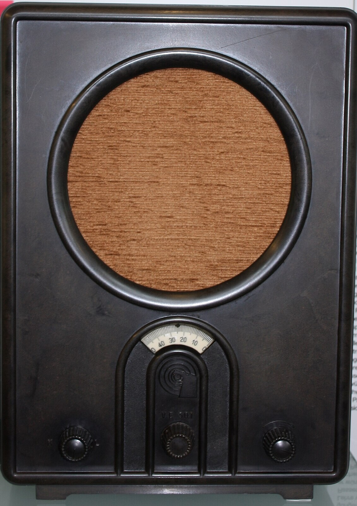

# The people's receiver

| | |
|---|---|
| **First made** | Berlin, 1933: the VE 301, designed by Otto Griessing at the firm of Dr. G. Seibt |
| **Made of** | A Bakelite case, three valves, a coil and a loudspeaker |
| **What it does** | Brings the government's broadcasts into the home at a fixed low price |
| **Before it** | Radio sets that most working families could not afford |
| **After it** | The smaller DKE 38 of 1938, at 35 marks, nicknamed "Goebbels' snout" |

## Why it mattered

The government fixed the price at 76 marks and made every large German radio maker build the same set to one design. The first 100,000 sold at the Berlin radio show in August 1933, where the set was launched, and several million followed. The number in its name stood for 30 January, the day Hitler became chancellor.

The set could pick up foreign stations after dark with a long aerial, so the law stepped in. A decree of September 1939 made it a crime to listen to them on purpose, punishable with hard labour. Passing on what they said could, in serious cases, be punished by death.

## The real thing

*A people's receiver, model VE 301 W, made by Aron/Heliowatt in 1933 or 1934, at the Obersalzberg Documentation Centre in Bavaria. Photo: Chantal Albert, CC BY-SA 3.0.*
