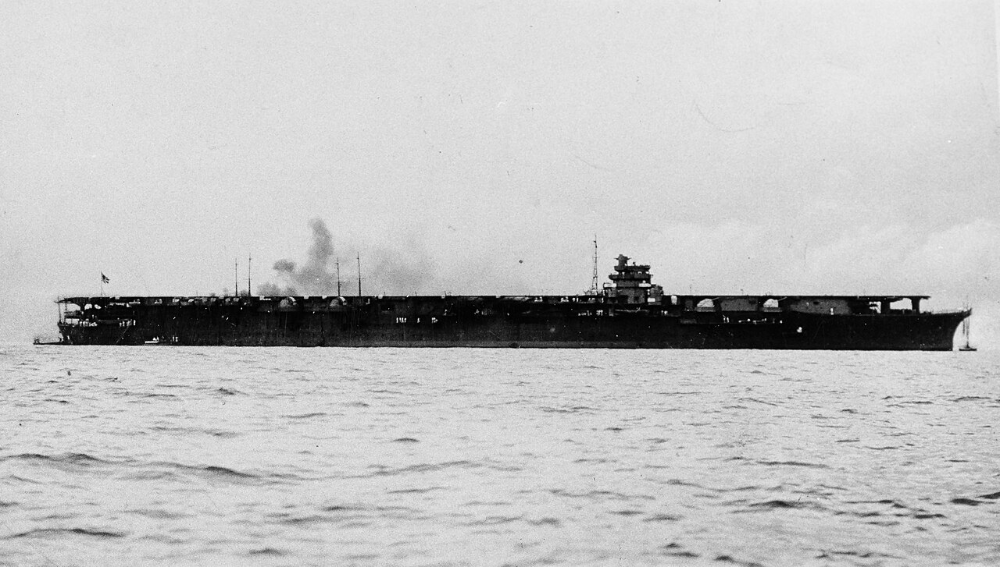

# The aircraft carrier

| | |
|---|---|
| **First made** | Britain, 1918: HMS *Argus*, a liner given a flat deck from end to end |
| **Made of** | A steel hull, with a flight deck of wooden planks laid on steel |
| **What it does** | Carries aircraft across the ocean, launches them and takes them back |
| **Before it** | The battleship, which could hit only what lay within reach of its guns |
| **After it** | The angled deck of the 1950s, which let a pilot who missed the wires try again |

![A long grey warship drawn from the side, sitting in the sea with its bow to the right. A red flat deck runs along the whole top of the ship, with three small aircraft parked on it, a small tower with a mast near the front, and short posts along the rear part of the deck. A fourth aircraft flies in from the left towards the rear of the deck. The rear half of the hull is cut open to show two long hangars, one above the other, each holding small aircraft, with dashed shafts running down through them. Two dark pipes come out of the side of the hull below the deck and bend downwards towards the water](carrier.png)

## Why it mattered

A battleship could strike only as far as its guns could throw a shell, about 40 kilometres. A carrier struck as far as its aircraft could fly and come back. On 7 December 1941 the Japanese carriers launched their first wave from about 370 kilometres north of Oahu. Five months later, in the Coral Sea, two fleets fought for two days without ever coming in sight of each other.

Many of the first big carriers began as something else. The Washington treaty of 1922 capped the battleships each navy could own, and that left half-built hulls with nowhere to go. Japan finished a battlecruiser as the *Akagi* and a battleship as the *Kaga*. The United States did the same with two battlecruisers, the *Lexington* and the *Saratoga*.

## The real thing

*The Shōkaku at Yokosuka on 23 August 1941. Photo: US Naval History and Heritage Command, public domain.*
