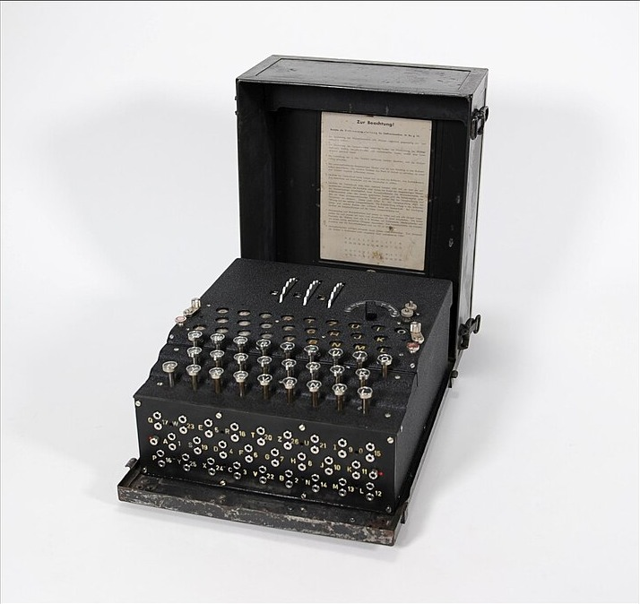

# The Enigma machine

| | |
|---|---|
| **First made** | Berlin, 1923: Arthur Scherbius's machine, patented in 1918 and sold to businesses before the armed forces took it up |
| **Made of** | A case holding a battery, 26 keys, 26 lamps, and wheels wired inside from one face to the other |
| **What it does** | Turns each letter typed into a different one, and changes the rule with every key press |
| **Before it** | Code books, and ciphers worked out by hand with pencil and paper |
| **After it** | The American SIGABA, with fifteen wheels and no reflector, which no enemy is known to have broken |

## Why it mattered

The machine worked both ways. The current went in through the wheels, bounced off the reflector and came back by another path, so typing the coded text into a machine set the same way gave back the plain message. That neat trick had a price: no letter could ever stand for itself. The codebreakers used it to slide a guessed word, such as the German word for weather, along a message until it fitted.

German operators added weaknesses of their own, choosing lazy settings and opening messages with the same words. On 1 February 1942, however, the U-boats changed to a machine with a fourth wheel, and their signals went dark for ten months. They were read again in December, with help from papers seized from a sinking U-boat.

## The real thing

*An Enigma I with three wheels, used by the German air force, in the Museum for Communication, Berlin. Photo: Museum für Kommunikation Berlin, CC BY-SA 4.0.*
