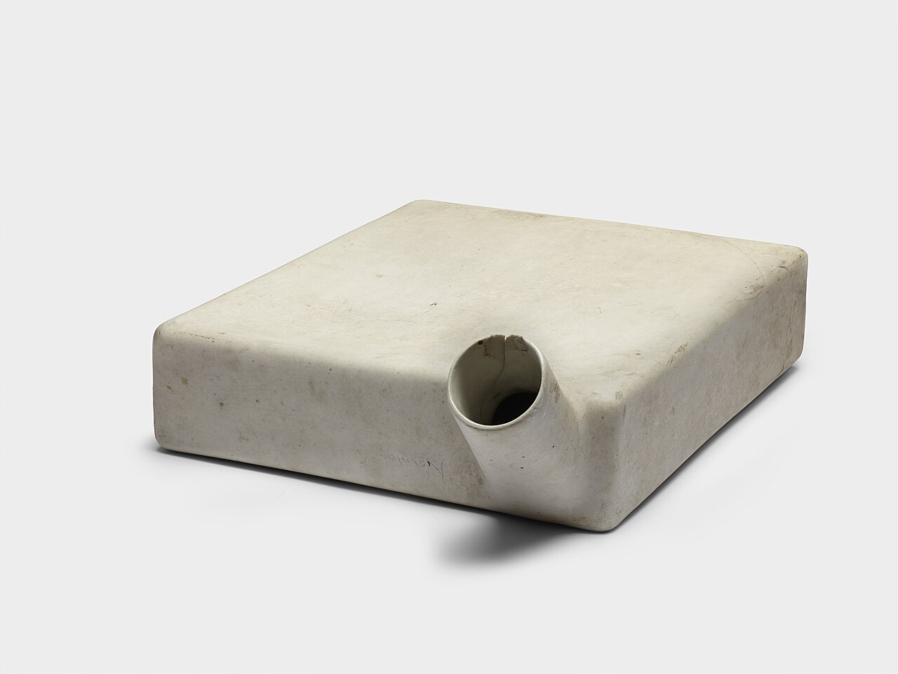

# Penicillin

| | |
|---|---|
| **First made** | Oxford, 1940: Howard Florey, Ernst Chain and Norman Heatley, from the mould Alexander Fleming found in 1928 |
| **Made of** | A mould, *Penicillium*, grown on the surface of a shallow broth |
| **What it does** | Kills many kinds of bacteria by stopping them from building their cell walls |
| **Before it** | The sulfa drugs of the 1930s, first made from a dye, which held bacteria back but did not kill them |
| **After it** | Streptomycin, found in a soil microbe in 1943, the first antibiotic to cure tuberculosis |

## Why it mattered

The mould makes very little of the drug. In 1940 it was grown as a mat floating on a shallow pool of liquid, which needs a wide, flat container, and nobody made such things in bulk. Heatley used whatever was flat and clean: pie dishes, biscuit tins, and bedpans borrowed from the Radcliffe Infirmary. Then he drew a pottery vessel of his own, and a firm in Staffordshire made 700 of them.

Six women were hired to seed the vessels with spores, tend them, and draw off the broth. The yield was tiny. It took about 2,000 litres of broth to make enough crude powder to treat one patient, and at its best the laboratory turned out 500 litres a week.

## The real thing

*A pottery culture vessel believed to be one of those used at Oxford to grow penicillin in the 1940s, now in the Science History Institute, Philadelphia. Photo: Science History Institute, public domain.*
