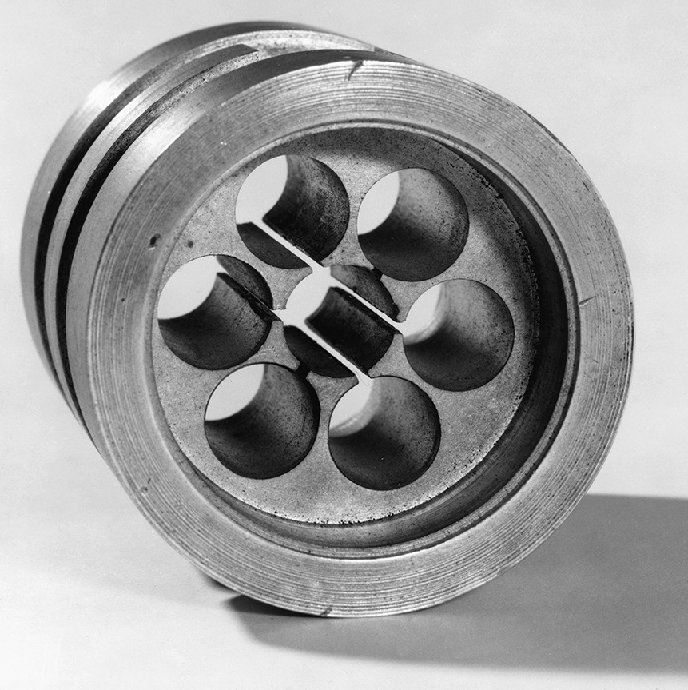

# The cavity magnetron

| | |
|---|---|
| **First made** | Birmingham, England, 1940: John Randall and Harry Boot, at the university |
| **Made of** | A copper block bored with holes, a heated cathode in the middle, and a strong magnet |
| **What it does** | Makes powerful radio waves only 10 centimetres long, the heart of a small radar set |
| **Before it** | Radar on waves metres long, which needed aerials too large to aim in a narrow beam |
| **After it** | The microwave oven, patented in 1945 by the magnetron maker Raytheon |

![Two drawings. At left, a round copper block cut across, with a small dark disc in the centre surrounded by curved blue strokes in a pale round space. Six red circular holes sit evenly in a ring around it, each joined to the central space by a narrow slot. A small wire loop sits in the upper right hole, and a thin pipe runs from it out through the edge of the block. At right, the same block seen edge on, standing between the two pole pieces of a large grey horseshoe magnet, with a wire coming out of the bottom](magnetron.png)

## Why it mattered

Radar sends out a pulse of radio waves and times the echo. The shorter the waves, the smaller the aerial needed to aim them in a narrow beam. Britain's coastal stations used waves about ten metres long, sent from steel masts 110 metres tall. The magnetron's waves were a hundred times shorter, and a dish that fitted inside an aircraft could aim them.

Within a week of its first run, in February 1940, it gave out a kilowatt. In September a British mission took one to America, where a new laboratory at the Massachusetts Institute of Technology grew to nearly 4,000 people. In 1943 the Germans recovered a set from a British bomber shot down near Rotterdam, and built receivers that let their night fighters home in on it.

## The real thing

*The copper block of Randall and Boot's original magnetron of 1940, with its six holes and the slots that join them to the middle, now in the Science Museum, London. Photo: Science Museum London / Science and Society Picture Library, CC BY-SA 2.0.*
