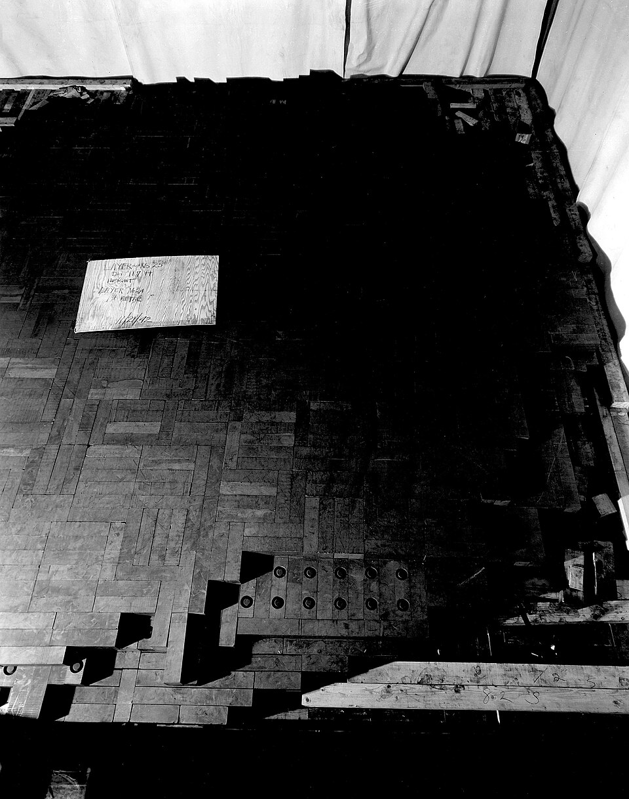

# The atomic pile

| | |
|---|---|
| **First made** | Chicago, 1942: Chicago Pile-1, built by Enrico Fermi's team at the university |
| **Made of** | About 45,000 graphite blocks, some 50 tonnes of uranium, and strips of cadmium |
| **What it does** | Keeps a chain reaction going at a steady rate, and stops it at will |
| **Before it** | Smaller stacks of graphite and uranium, too small to keep a reaction going |
| **After it** | Hanford's B Reactor of 1944, at over a million times the power |

## Why it mattered

The pile worked by numbers. Each uranium atom that splits throws out two or three neutrons, and most are lost, escaping or soaked up without causing a split. With the rods pushed in, too few survived to keep the reaction going. As the rods came out, the count rose until each split caused, on average, slightly more than one other, and the reaction fed itself.

Stacking took about two weeks. About thirty young men who had left school early machined and laid the graphite in twelve-hour shifts. The pile had no shielding, so it was never run above 200 watts. In 1943 it was rebuilt behind concrete walls in a forest outside the city.

## The real thing

*The pile half built, on 21 November 1942: a layer of graphite bricks, with blocks bored for uranium in front. Photo: US Department of Energy, public domain.*
