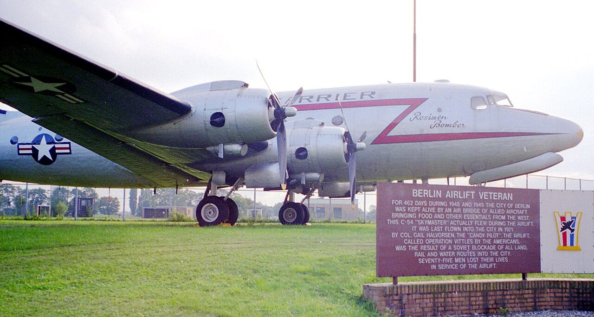

# The airlift transport

| | |
|---|---|
| **First made** | Santa Monica, California, 1942: the army's version of Douglas's DC-4 airliner |
| **Made of** | An aluminium body, and four radial engines driving propellers |
| **What it does** | Carries about ten tons of cargo on a level floor |
| **Before it** | The Douglas C-47, which carried three and a half tons |
| **After it** | The Lockheed C-130 of 1954, loaded up a ramp at the tail |

## Why it mattered

The wartime workhorse, the twin-engined C-47, sat back on a small tail wheel, so its floor sloped uphill towards the cockpit. The C-54 stood on a wheel under its nose, and its floor lay flat. It carried three times as much, yet it took no longer to empty. The airlift's commander, William Tunner, set out to replace every C-47 with one, and in the end about 330 of the type took part.

Speed came from routine. Aircraft landed three minutes apart, and a pilot who missed his approach flew straight home with his load rather than circle. One ground crew of twelve emptied ten tons of coal in under six minutes. At Easter 1949 the airlift delivered almost 13,000 tons in a single day.

## The real thing

*A C-54 that flew in the airlift, kept as a memorial at Tempelhof airport, Berlin, in 2001. Photo: kitmasterbloke, CC BY 4.0.*
