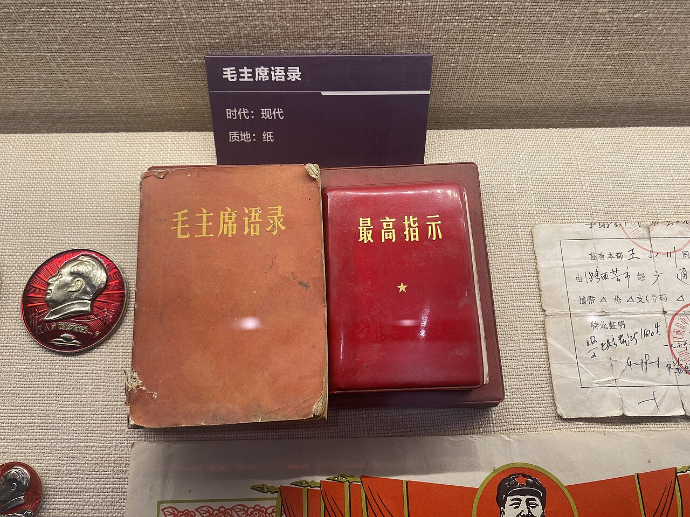

# The little red book

| | |
|---|---|
| **First made** | Beijing, 1964: compiled by the army's newspaper for its soldiers |
| **Made of** | Thin paper pages in a cover of red vinyl over card |
| **What it does** | Puts 427 short sayings of Mao in every pocket |
| **Before it** | A daily Mao quotation in the army newspaper, from 1961 |
| **After it** | Printing halted in 1979, the book called a distortion of Mao's thought |

## Why it mattered

The book grew out of army drill, in which soldiers studied Mao's words alongside the lives of model heroes. Its sayings were sorted into 33 chapters, from "The Communist Party" to "Study", so that a fitting line could be found for any occasion. The first 4.2 million copies went to the army alone. In 1965 the paper cover gave way to red vinyl, which lasted better in the field.

Its patron was the defence minister, Lin Biao. A tribute in his handwriting stood at the front, and from the end of 1966 he signed the foreword too. After his death in 1971 the party ordered his pages removed, and owners across China cut them out of their copies.

## The real thing

*A worn Chinese copy, left, beside a book of Mao's "Supreme Instructions", in the Dehong Prefecture Museum, Yunnan. Photo: 瑞丽江的河水, CC BY-SA 4.0.*
