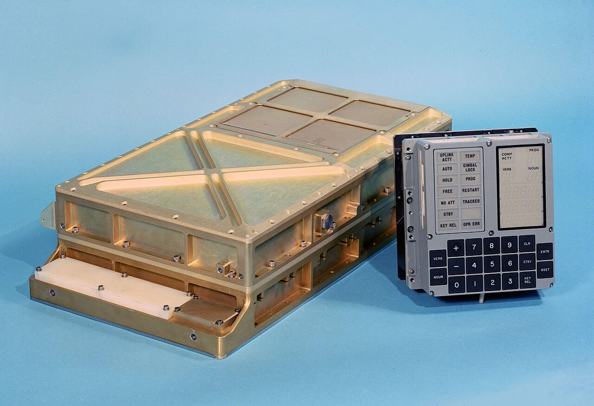

# The guidance computer

| | |
|---|---|
| **First made** | Cambridge, Massachusetts, 1966: designed at MIT, built by Raytheon |
| **Made of** | About 2,800 silicon chips, magnetic rings, and copper wire threaded by hand |
| **What it does** | Steers the spacecraft, following programs woven into wire |
| **Before it** | IBM's computer for the Gemini capsule, 1965, built without chips |
| **After it** | A NASA jet of 1972, its controls run through an Apollo computer |

![On the left, a dark grey control panel with two columns of pale warning lights at the top left and a black window showing green numbers labelled PROG, VERB and NOUN, and below them nineteen square keys in seven columns. A cable joins it to a sand-coloured metal box in the middle, whose front shows a row of narrow trays on the left and six paler modules on the right. On the right, a magnified circle shows three red rings in a row with thin copper wires running through their holes or looping over the top of them](guidance-computer.png)

## Why it mattered

The whole machine was built from one kind of chip, repeated about 2,800 times. Each chip held two identical gates, the simplest kind of logic circuit, and every calculation came from wiring them together. Each flight to the Moon carried two of these computers, one in the command ship and one in the lander.

The crew spoke to it in numbers: a verb for the action, a noun for the thing acted on. Since the woven programs could not be changed, a fault found late had to be worked around. On Apollo 14 a loose ball of solder in a switch threatened to abort the landing, so an engineer in Massachusetts wrote a string of keystrokes that the crew typed in to get past it.

## The real thing

*The guidance computer in its gold-coloured case, beside its display and keyboard. Photo: NASA, public domain.*
