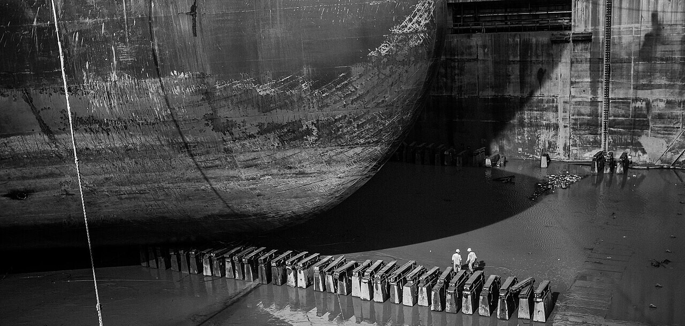

# The oil tanker

| | |
|---|---|
| **First made** | Kure, Japan, 1959: the Universe Apollo, the first tanker over 100,000 tons |
| **Made of** | Welded steel plate, divided inside into many separate tanks |
| **What it does** | Carries 200,000 tons or more of crude oil across oceans |
| **Before it** | The T2 tanker of the Second World War, carrying 16,500 tons |
| **After it** | Double hulls, required after the Exxon Valdez spill of 1989 |

## Why it mattered

A tanker is a floating box, and boxes reward size. Double a ship's length, width and depth, and it holds eight times as much oil, while the surface of its hull grows only fourfold. When the Suez Canal was closed in 1956, and again from 1967 to 1975, oil from the Gulf had to go round Africa, and the long voyage favoured the biggest ships. By 1979 the largest was 458 metres long.

Size had a price. In 1967 the Torrey Canyon, built for 60,000 tons and enlarged to 120,000, ran onto a reef between Cornwall and the Isles of Scilly. Its oil fouled about 190 kilometres of Cornish coast and 80 of French, and navy jets bombed the wreck to set the rest alight.

## The real thing

*The bulb under the bow of a 340,000-ton supertanker in dry dock in China; two workers below. Photo: Eric Gao, CC BY 3.0.*
